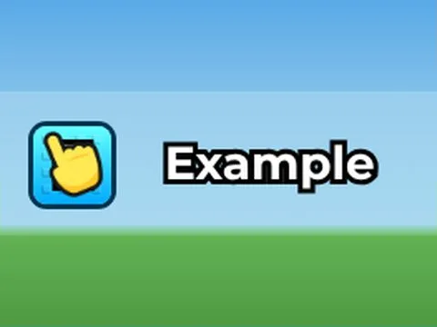

# Custom Prompt

Interface « Custom Prompt ». 7 éléments UI.

- **Catégorie** : [Interfaces](../Interfaces.md)
- **Sous-catégorie** : [Steal an Spooky Egg](Steal%20an%20Spooky%20Egg%20%28Interfaces%29.md)
- **Type** : Interface (ScreenGui)
- **Contenu** : 7 éléments UI
- **Fichier source** : `ui/SpookyGame/Templates/CustomPrompt.rbxm` (dans ta bibliothèque `rblx\lib`)
