# Steal an Spooky Egg

Sous-catégorie de [Interfaces](../Interfaces.md) · **33 éléments**

| Aperçu | Élément | Infos |
| --- | --- | --- |
|  | [Archive Bouton Base HUD](Archive%20Bouton%20Base%20HUD.md) | Interface (ScreenGui) · 13 éléments UI |
| 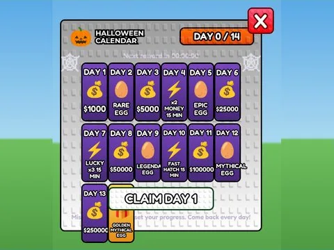 | [Archive Calendar v1](Archive%20Calendar%20v1.md) | Interface (ScreenGui) · 75 éléments UI |
| 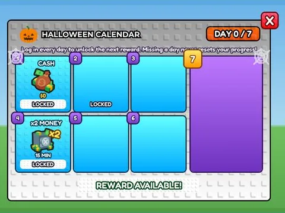 | [Archive Frames v1](Archive%20Frames%20v1.md) | Interface (ScreenGui) · 293 éléments UI |
|  | [Archive Index v1](Archive%20Index%20v1.md) | Interface (ScreenGui) · 8 éléments UI |
|  | [Archive Quests List](Archive%20Quests%20List.md) | Interface (ScreenGui) · 25 éléments UI |
|  | [Archive Shop v1](Archive%20Shop%20v1.md) | Interface (ScreenGui) · 164 éléments UI |
|  | [Archive VIP Frame](Archive%20VIP%20Frame.md) | Interface (ScreenGui) · 37 éléments UI |
|  | [Calendar](Calendar.md) | Interface (ScreenGui) · 90 éléments UI |
| 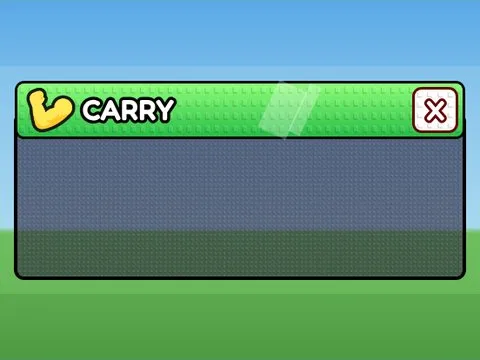 | [Carry](Carry%20%C2%B7%20Steal%20an%20Spooky%20Egg.md) | Interface (ScreenGui) · 12 éléments UI |
| 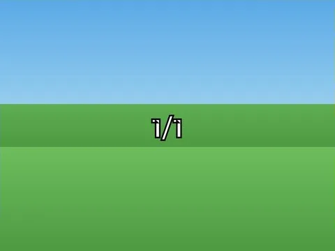 | [Carry GUI](Carry%20GUI.md) | Interface (ScreenGui) · 2 éléments UI |
|  | [Carry Template](Carry%20Template.md) | Interface (ScreenGui) · 20 éléments UI |
| 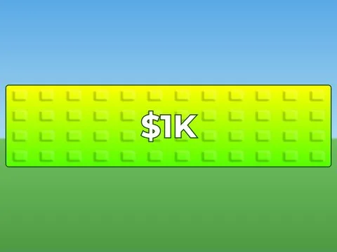 | [Collect GUI](Collect%20GUI.md) | Interface (ScreenGui) · 4 éléments UI |
|  | [Custom Prompt](Custom%20Prompt.md) | Interface (ScreenGui) · 7 éléments UI |
|  | [HUD](HUD.md) | Interface (ScreenGui) · 85 éléments UI |
|  | [Index](Index.md) | Interface (ScreenGui) · 49 éléments UI |
|  | [Index Template](Index%20Template.md) | Interface (ScreenGui) · 9 éléments UI |
|  | [Info GUI](Info%20GUI.md) | Interface (ScreenGui) · 6 éléments UI |
| 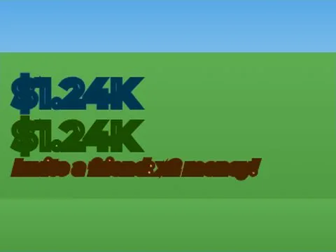 | [Labels](Labels.md) | Interface (ScreenGui) · 5 éléments UI |
|  | [Leaderboard](Leaderboard.md) | Interface (ScreenGui) · 40 éléments UI |
| 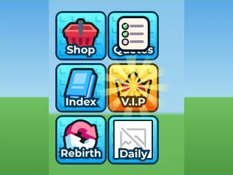 | [Left](Left.md) | Interface (ScreenGui) · 54 éléments UI |
|  | [Lobby Teleport Gui](Lobby%20Teleport%20Gui.md) | Interface (ScreenGui) · 16 éléments UI |
| 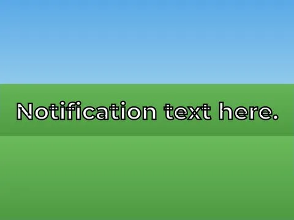 | [Notification Template](Notification%20Template.md) | Interface (ScreenGui) · 1 élément UI |
| 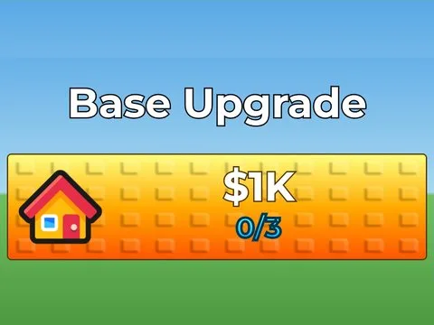 | [Plot Upgrade GUI](Plot%20Upgrade%20GUI.md) | Interface (ScreenGui) · 7 éléments UI |
| 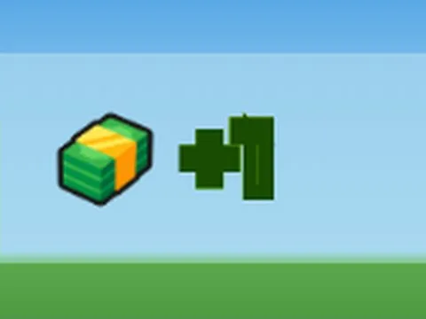 | [Pop Up](Pop%20Up.md) | Interface (ScreenGui) · 3 éléments UI |
|  | [Quests](Quests.md) | Interface (ScreenGui) · 83 éléments UI |
| 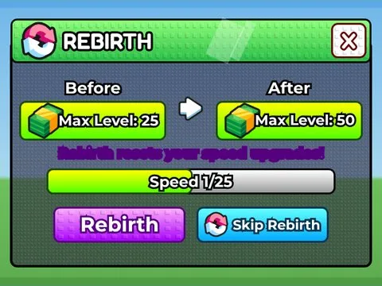 | [Rebirth](Rebirth%20%C2%B7%20Steal%20an%20Spooky%20Egg.md) | Interface (ScreenGui) · 37 éléments UI |
|  | [Revenge Gui](Revenge%20Gui.md) | Interface (ScreenGui) · 10 éléments UI |
|  | [Right](Right.md) | Interface (ScreenGui) · 25 éléments UI |
| 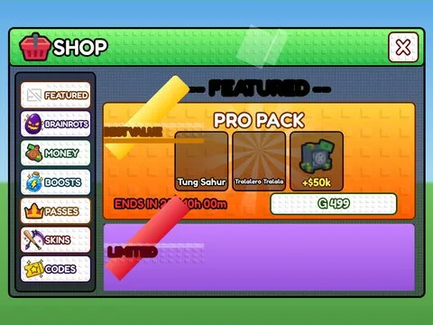 | [Shop](Shop.md) | Interface (ScreenGui) · 259 éléments UI |
|  | [Speed](Speed.md) | Interface (ScreenGui) · 12 éléments UI |
| 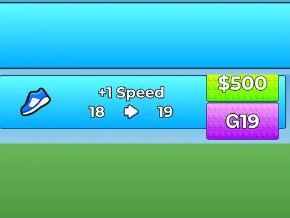 | [Speed Template](Speed%20Template.md) | Interface (ScreenGui) · 20 éléments UI |
|  | [Trash](Trash.md) | Interface (ScreenGui) · 4 éléments UI |
|  | [Upgrade GUI](Upgrade%20GUI.md) | Interface (ScreenGui) · 6 éléments UI |
