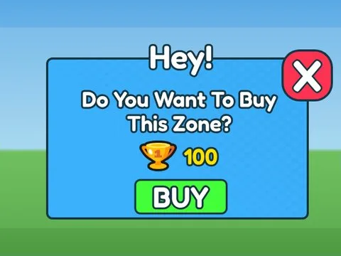

# Teleport Zones · Mining Masters

Interface « Teleport Zones » du jeu Mining Masters. 11 éléments UI.

- **Catégorie** : [Interfaces](../Interfaces.md)
- **Sous-catégorie** : [Téléport & zones](T%C3%A9l%C3%A9port%20&%20zones.md)
- **Type** : Interface (ScreenGui)
- **Contenu** : 11 éléments UI
- **Jeu d'origine** : Mining Masters
- **Fichier source** : `ui/ByType/Teleport_Zones/MiningMasters_TeleportZones.rbxm` (dans ta bibliothèque `rblx\lib`)
