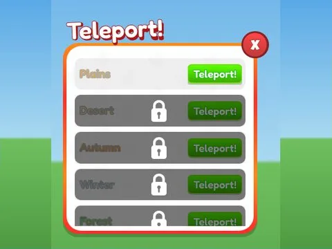

# Teleport · Pet Pharmica

Interface « Teleport » du jeu Pet Pharmica. 66 éléments UI.

- **Catégorie** : [Interfaces](../Interfaces.md)
- **Sous-catégorie** : [Téléport & zones](T%C3%A9l%C3%A9port%20&%20zones.md)
- **Type** : Interface (ScreenGui)
- **Contenu** : 66 éléments UI
- **Jeu d'origine** : Pet Pharmica
- **Fichier source** : `ui/ByType/Teleport_Zones/PetPharmica_Teleport.rbxm` (dans ta bibliothèque `rblx\lib`)
