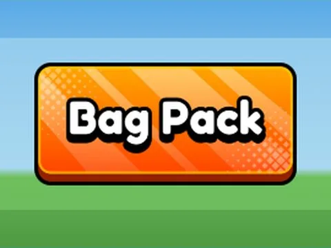

# Btn Bag Pack

Interface « Btn Bag Pack ». 1 éléments UI.

- **Catégorie** : [Interfaces](../Interfaces.md)
- **Sous-catégorie** : [UI Mega Pack](UI%20Mega%20Pack.md)
- **Type** : Interface (ScreenGui)
- **Contenu** : 1 élément UI
- **Fichier source** : `ui/Roblox Ui Model/UIMegaPack/TextButtons/Btn_BagPack.rbxm` (dans ta bibliothèque `rblx\lib`)
