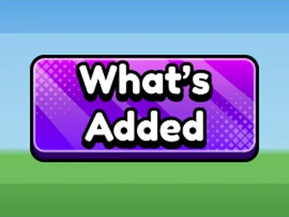

# Btn Whats Added

Interface « Btn Whats Added ». 1 éléments UI.

- **Catégorie** : [Interfaces](../Interfaces.md)
- **Sous-catégorie** : [UI Mega Pack](UI%20Mega%20Pack.md)
- **Type** : Interface (ScreenGui)
- **Contenu** : 1 élément UI
- **Fichier source** : `Assets/ui/Roblox Ui Model/UIMegaPack/TextButtons/Btn_WhatsAdded.rbxm` (dans le vault)
