# UI Mega Pack

Sous-catégorie de [Interfaces](../Interfaces.md) · **48 éléments**

| Aperçu | Élément | Infos |
| --- | --- | --- |
|  | [Btn Back](Btn%20Back.md) | Interface (ScreenGui) · 1 élément UI |
|  | [Btn Bag Pack](Btn%20Bag%20Pack.md) | Interface (ScreenGui) · 1 élément UI |
|  | [Btn Codes](Btn%20Codes.md) | Interface (ScreenGui) · 1 élément UI |
|  | [Btn Correct](Btn%20Correct.md) | Interface (ScreenGui) · 1 élément UI |
|  | [Btn Delete](Btn%20Delete.md) | Interface (ScreenGui) · 1 élément UI |
|  | [Btn Forward](Btn%20Forward.md) | Interface (ScreenGui) · 1 élément UI |
| 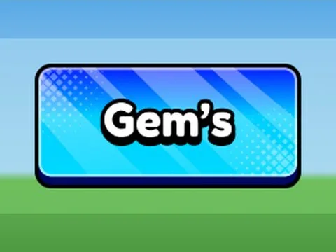 | [Btn Gems](Btn%20Gems.md) | Interface (ScreenGui) · 1 élément UI |
| 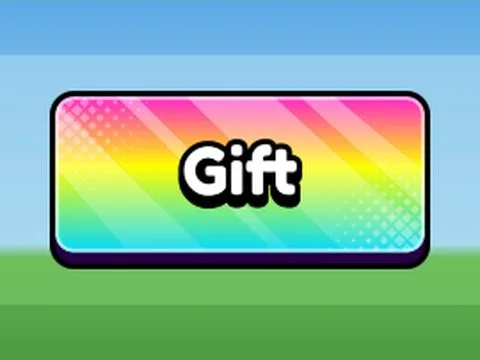 | [Btn Gift](Btn%20Gift.md) | Interface (ScreenGui) · 1 élément UI |
|  | [Btn Inventory](Btn%20Inventory.md) | Interface (ScreenGui) · 1 élément UI |
| 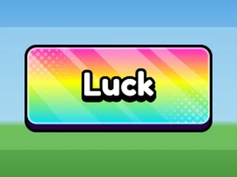 | [Btn Luck](Btn%20Luck.md) | Interface (ScreenGui) · 1 élément UI |
|  | [Btn Money](Btn%20Money.md) | Interface (ScreenGui) · 1 élément UI |
| 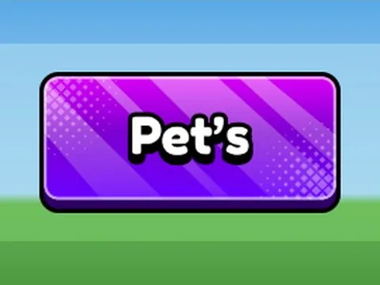 | [Btn Pets](Btn%20Pets.md) | Interface (ScreenGui) · 1 élément UI |
|  | [Btn Rebirth](Btn%20Rebirth.md) | Interface (ScreenGui) · 1 élément UI |
|  | [Btn Robux](Btn%20Robux.md) | Interface (ScreenGui) · 1 élément UI |
| 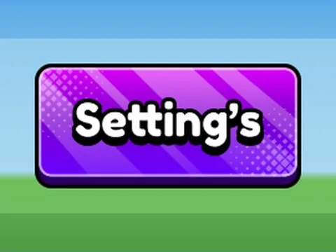 | [Btn Settings](Btn%20Settings.md) | Interface (ScreenGui) · 1 élément UI |
|  | [Btn Shop](Btn%20Shop.md) | Interface (ScreenGui) · 1 élément UI |
|  | [Btn Super Gems](Btn%20Super%20Gems.md) | Interface (ScreenGui) · 1 élément UI |
|  | [Btn Trade](Btn%20Trade.md) | Interface (ScreenGui) · 1 élément UI |
|  | [Btn Update Log](Btn%20Update%20Log.md) | Interface (ScreenGui) · 1 élément UI |
|  | [Btn Whats Added](Btn%20Whats%20Added.md) | Interface (ScreenGui) · 1 élément UI |
|  | [Btn Wheel Spin](Btn%20Wheel%20Spin.md) | Interface (ScreenGui) · 1 élément UI |
|  | [Icon Back](Icon%20Back.md) | Interface (ScreenGui) · 1 élément UI |
|  | [Icon Codes](Icon%20Codes.md) | Interface (ScreenGui) · 1 élément UI |
|  | [Icon Correct](Icon%20Correct.md) | Interface (ScreenGui) · 1 élément UI |
| 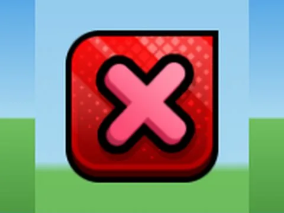 | [Icon Delete](Icon%20Delete.md) | Interface (ScreenGui) · 1 élément UI |
|  | [Icon Forward](Icon%20Forward.md) | Interface (ScreenGui) · 1 élément UI |
|  | [Icon Gems](Icon%20Gems.md) | Interface (ScreenGui) · 1 élément UI |
| 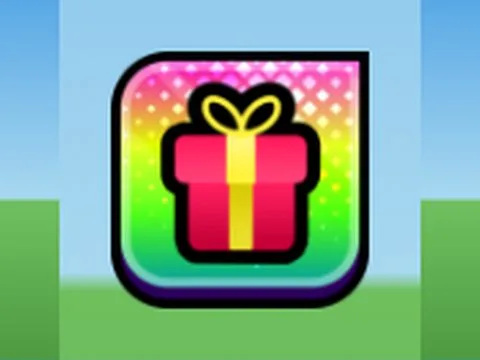 | [Icon Gift](Icon%20Gift.md) | Interface (ScreenGui) · 1 élément UI |
| 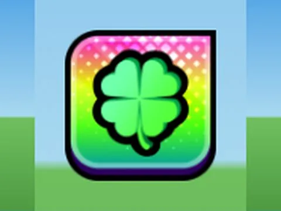 | [Icon Luck](Icon%20Luck.md) | Interface (ScreenGui) · 1 élément UI |
|  | [Icon Minus](Icon%20Minus.md) | Interface (ScreenGui) · 1 élément UI |
|  | [Icon Money](Icon%20Money.md) | Interface (ScreenGui) · 1 élément UI |
| 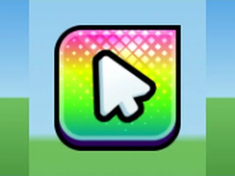 | [Icon Mouse](Icon%20Mouse.md) | Interface (ScreenGui) · 1 élément UI |
|  | [Icon Pets](Icon%20Pets.md) | Interface (ScreenGui) · 1 élément UI |
|  | [Icon Plus](Icon%20Plus.md) | Interface (ScreenGui) · 1 élément UI |
| 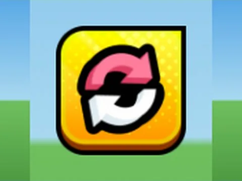 | [Icon Rebirth](Icon%20Rebirth.md) | Interface (ScreenGui) · 1 élément UI |
| 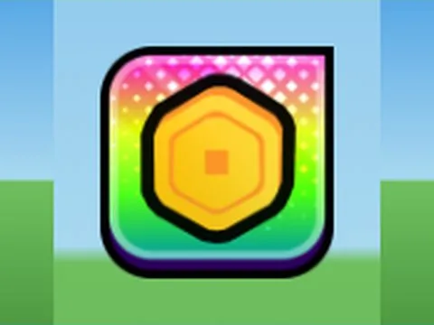 | [Icon Robux](Icon%20Robux.md) | Interface (ScreenGui) · 1 élément UI |
| 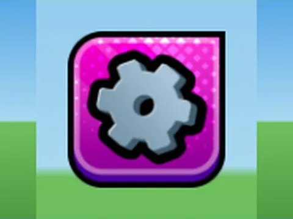 | [Icon Settings](Icon%20Settings.md) | Interface (ScreenGui) · 1 élément UI |
|  | [Icon Shop](Icon%20Shop.md) | Interface (ScreenGui) · 1 élément UI |
| 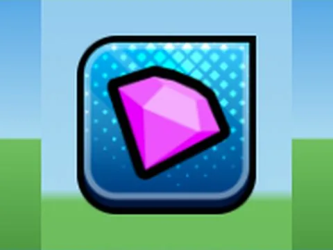 | [Icon Super Gems](Icon%20Super%20Gems.md) | Interface (ScreenGui) · 1 élément UI |
|  | [Icon Trade](Icon%20Trade.md) | Interface (ScreenGui) · 1 élément UI |
| 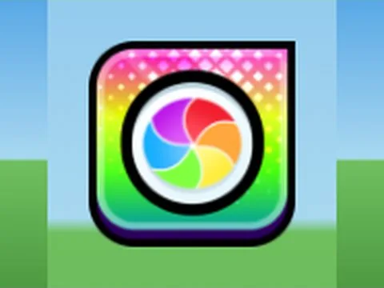 | [Icon Wheel Spin](Icon%20Wheel%20Spin.md) | Interface (ScreenGui) · 1 élément UI |
|  | [Panel Blue](Panel%20Blue.md) | Interface (ScreenGui) · 1 élément UI |
|  | [Panel Green](Panel%20Green.md) | Interface (ScreenGui) · 1 élément UI |
|  | [Panel Grey](Panel%20Grey.md) | Interface (ScreenGui) · 1 élément UI |
|  | [Panel Orange](Panel%20Orange.md) | Interface (ScreenGui) · 1 élément UI |
| 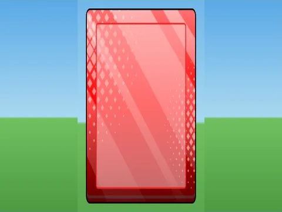 | [Panel Red](Panel%20Red.md) | Interface (ScreenGui) · 1 élément UI |
| 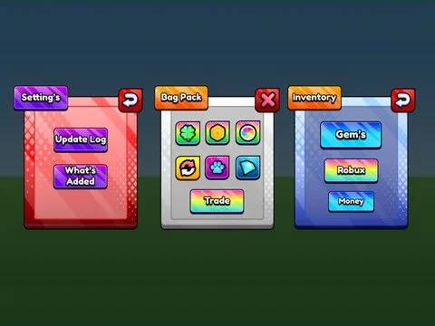 | [Show Case Example](Show%20Case%20Example.md) | Interface (ScreenGui) · 22 éléments UI |
|  | [UIMega Pack Full Screen Gui](UIMega%20Pack%20Full%20Screen%20Gui.md) | Interface (ScreenGui) · 47 éléments UI |
