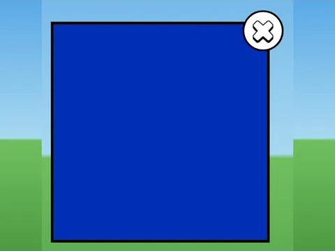

# Trade List · Punch Simulator

Interface « Trade List » du jeu Punch Simulator. 4 éléments UI.

- **Catégorie** : [Interfaces](../Interfaces.md)
- **Sous-catégorie** : [Échanges](%C3%89changes.md)
- **Type** : Interface (ScreenGui)
- **Contenu** : 4 éléments UI
- **Jeu d'origine** : Punch Simulator
- **Fichier source** : `ui/ByType/Trade/PunchSim_TradeList.rbxm` (dans ta bibliothèque `rblx\lib`)
