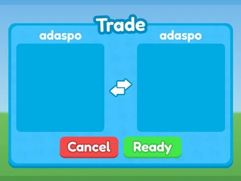

# Trade · Rebirth Champions X

Interface « Trade » du jeu Rebirth Champions X. 21 éléments UI.

- **Catégorie** : [Interfaces](../Interfaces.md)
- **Sous-catégorie** : [Échanges](%C3%89changes.md)
- **Type** : Interface (ScreenGui)
- **Contenu** : 21 éléments UI
- **Jeu d'origine** : Rebirth Champions X
- **Fichier source** : `ui/ByType/Trade/RebirthChampionsX_Trade.rbxm` (dans ta bibliothèque `rblx\lib`)
