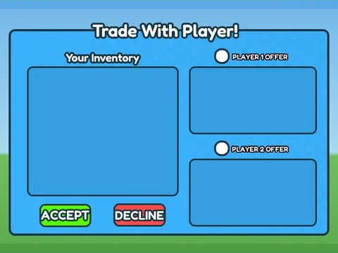
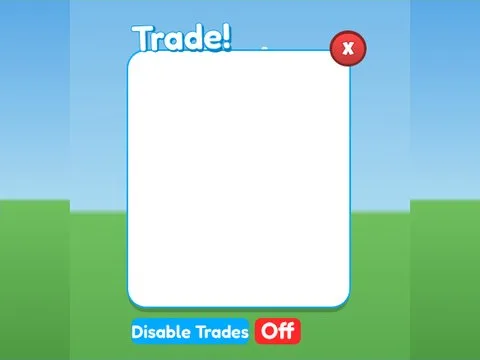
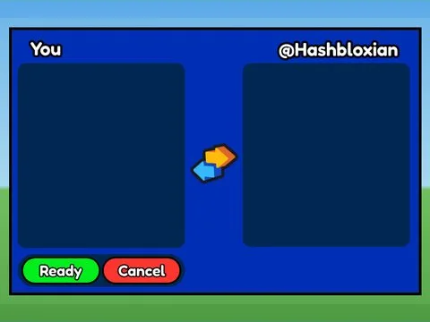
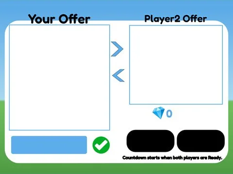

# Échanges

Sous-catégorie de [Interfaces](../Interfaces.md) · **7 éléments**

| Aperçu | Élément | Infos |
| --- | --- | --- |
|  | [Trade · Hatching Simulator](Trade%20%C2%B7%20Hatching%20Simulator.md) | Interface (ScreenGui) · 7 éléments UI |
|  | [Trade · Mining Masters](Trade%20%C2%B7%20Mining%20Masters.md) | Interface (ScreenGui) · 17 éléments UI |
|  | [Trade · Pet Pharmica](Trade%20%C2%B7%20Pet%20Pharmica.md) | Interface (ScreenGui) · 15 éléments UI |
|  | [Trade · Punch Simulator](Trade%20%C2%B7%20Punch%20Simulator.md) | Interface (ScreenGui) · 16 éléments UI |
|  | [Trade · Rebirth Champions X](Trade%20%C2%B7%20Rebirth%20Champions%20X.md) | Interface (ScreenGui) · 21 éléments UI |
|  | [Trade Frame · Pet Pharmica](Trade%20Frame%20%C2%B7%20Pet%20Pharmica.md) | Interface (ScreenGui) · 21 éléments UI |
|  | [Trade List · Punch Simulator](Trade%20List%20%C2%B7%20Punch%20Simulator.md) | Interface (ScreenGui) · 4 éléments UI |
