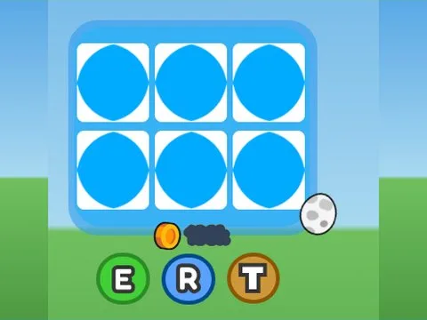

# Egg Preview · Pet Pharmica

Interface « Egg Preview » du jeu Pet Pharmica. 41 éléments UI.

- **Catégorie** : [Interfaces](../Interfaces.md)
- **Sous-catégorie** : [Œufs & éclosion](%C5%92ufs%20&%20%C3%A9closion.md)
- **Type** : Interface (ScreenGui)
- **Contenu** : 41 éléments UI
- **Jeu d'origine** : Pet Pharmica
- **Fichier source** : `Assets/ui/ByType/Eggs_Hatch/PetPharmica_EggPreview.rbxm` (dans le vault)
