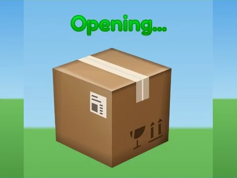

# Lootbox Open · Tapping Lords

Interface « Lootbox Open » du jeu Tapping Lords. 8 éléments UI.

- **Catégorie** : [Interfaces](../Interfaces.md)
- **Sous-catégorie** : [Œufs & éclosion](%C5%92ufs%20%26%20%C3%A9closion.md)
- **Type** : Interface (ScreenGui)
- **Contenu** : 8 éléments UI
- **Jeu d'origine** : Tapping Lords
- **Fichier source** : `ui/ByType/Eggs_Hatch/TappingLords_LootboxOpen.rbxm` (dans ta bibliothèque `rblx\lib`)
