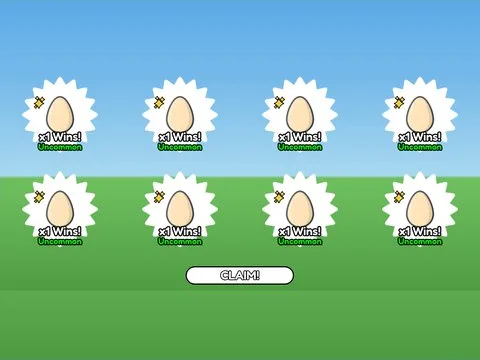

# Reward Showcase · Glass Bridge

Interface « Reward Showcase » du jeu Glass Bridge. 66 éléments UI.

- **Catégorie** : [Interfaces](../Interfaces.md)
- **Sous-catégorie** : [Œufs & éclosion](%C5%92ufs%20%26%20%C3%A9closion.md)
- **Type** : Interface (ScreenGui)
- **Contenu** : 66 éléments UI
- **Jeu d'origine** : Glass Bridge
- **Fichier source** : `ui/ByType/Eggs_Hatch/GlassBridge_RewardShowcase.rbxm` (dans ta bibliothèque `rblx\lib`)
