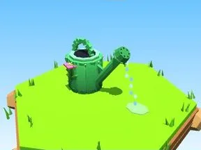

# Arrosoir vert

Arrosoir riveté avec pomme d’arrosage et filet d’eau.

- **Catégorie** : [Outils](Outils.md)
- **Type** : Modèle low-poly
- **Taille** : 8 × 5 × 4 studs

## Variantes

- [Arrosoir bleu](Arrosoir%20bleu.md)
- [Arrosoir rose](Arrosoir%20rose.md)
- [Arrosoir doré](Arrosoir%20dor%C3%A9.md)
