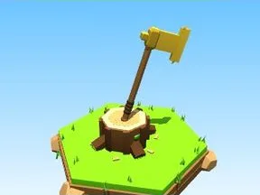

# Hache dorée

Hache plantée dans une souche, copeaux au sol.

- **Catégorie** : [Outils](Outils.md)
- **Type** : Modèle low-poly
- **Taille** : 6 × 10 × 6 studs

## Variantes

- [Hache en fer](Hache%20en%20fer.md)
