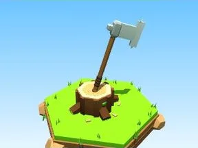

# Hache en fer

Hache plantée dans une souche, copeaux au sol.

- **Catégorie** : [Outils](Outils.md)
- **Type** : Modèle low-poly
- **Taille** : 6 × 10 × 6 studs

## Variantes

- [Hache dorée](Hache%20dor%C3%A9e.md)
