# Outils

**37 éléments**

| Aperçu | Élément | Infos |
| --- | --- | --- |
| 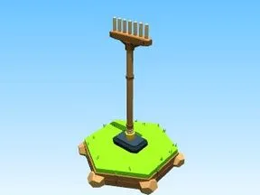 | [Râteau en bois](R%C3%A2teau%20en%20bois.md) | Modèle low-poly · 5 × 13 × 2 |
| 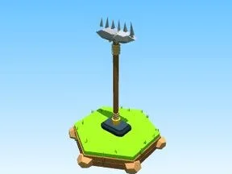 | [Râteau en pierre](R%C3%A2teau%20en%20pierre.md) | Modèle low-poly · 5 × 14 × 2 |
|  | [Râteau en fer](R%C3%A2teau%20en%20fer.md) | Modèle low-poly · 5 × 13 × 2 |
| 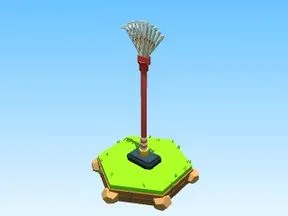 | [Râteau à feuilles rouge](R%C3%A2teau%20%C3%A0%20feuilles%20rouge.md) | Modèle low-poly · 5 × 15 × 2 |
| 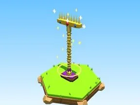 | [Râteau doré](R%C3%A2teau%20dor%C3%A9.md) | Modèle low-poly · 7 × 14 × 5 |
| 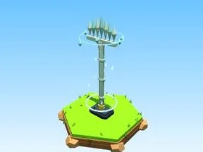 | [Râteau diamant](R%C3%A2teau%20diamant.md) | Modèle low-poly · 6 × 15 × 6 |
| 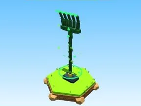 | [Râteau émeraude](R%C3%A2teau%20%C3%A9meraude.md) | Modèle low-poly · 5 × 15 × 5 |
| 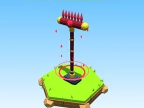 | [Râteau rubis](R%C3%A2teau%20rubis.md) | Modèle low-poly · 7 × 14 × 7 |
| 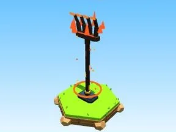 | [Râteau de lave](R%C3%A2teau%20de%20lave.md) | Modèle low-poly · 5 × 15 × 5 |
| 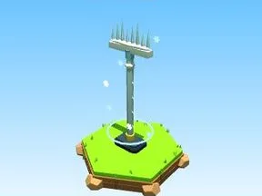 | [Râteau de glace](R%C3%A2teau%20de%20glace.md) | Modèle low-poly · 6 × 14 × 5 |
| 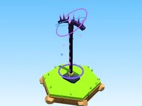 | [Râteau du Void](R%C3%A2teau%20du%20Void.md) | Modèle low-poly · 6 × 15 × 6 |
| 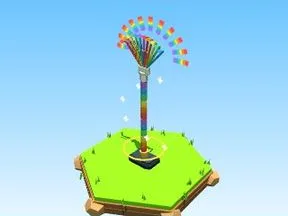 | [Râteau arc-en-ciel](R%C3%A2teau%20arc-en-ciel.md) | Modèle low-poly · 9 × 17 × 5 |
| 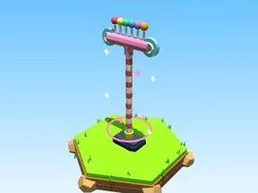 | [Râteau bonbon](R%C3%A2teau%20bonbon.md) | Modèle low-poly · 7 × 14 × 5 |
| 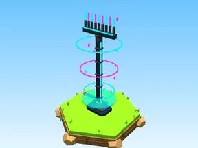 | [Râteau néon](R%C3%A2teau%20n%C3%A9on.md) | Modèle low-poly · 6 × 14 × 6 |
| 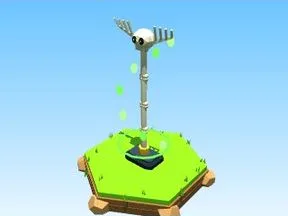 | [Râteau squelette](R%C3%A2teau%20squelette.md) | Modèle low-poly · 6 × 13 × 5 |
| 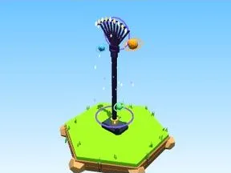 | [Râteau galaxie](R%C3%A2teau%20galaxie.md) | Modèle low-poly · 8 × 16 × 5 |
|  | [Râteau Brainrot SECRET](R%C3%A2teau%20Brainrot%20SECRET.md) | Modèle low-poly · 8 × 17 × 7 |
|  | [Sac de récolte S](Sac%20de%20r%C3%A9colte%20S.md) | Modèle low-poly · 3 × 4 × 3 |
| 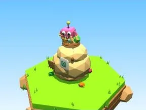 | [Sac de récolte M](Sac%20de%20r%C3%A9colte%20M.md) | Modèle low-poly · 4 × 5 × 3 |
|  | [Sac de récolte L](Sac%20de%20r%C3%A9colte%20L.md) | Modèle low-poly · 5 × 6 × 5 |
|  | [Sac de récolte XL](Sac%20de%20r%C3%A9colte%20XL.md) | Modèle low-poly · 7 × 8 × 6 |
|  | [Pelle en bois](Pelle%20en%20bois.md) | Modèle low-poly · 5 × 10 × 4 |
| 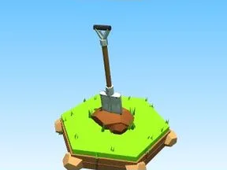 | [Pelle en fer](Pelle%20en%20fer.md) | Modèle low-poly · 5 × 10 × 4 |
|  | [Pelle dorée](Pelle%20dor%C3%A9e.md) | Modèle low-poly · 5 × 10 × 5 |
|  | [Arrosoir vert](Arrosoir%20vert.md) | Modèle low-poly · 8 × 5 × 4 |
|  | [Arrosoir bleu](Arrosoir%20bleu.md) | Modèle low-poly · 8 × 5 × 4 |
| 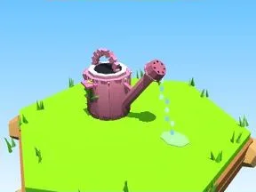 | [Arrosoir rose](Arrosoir%20rose.md) | Modèle low-poly · 8 × 5 × 4 |
|  | [Arrosoir doré](Arrosoir%20dor%C3%A9.md) | Modèle low-poly · 8 × 5 × 4 |
|  | [Pioche en pierre](Pioche%20en%20pierre.md) | Modèle low-poly · 8 × 9 × 5 |
| 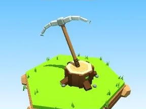 | [Pioche en fer](Pioche%20en%20fer.md) | Modèle low-poly · 8 × 9 × 5 |
| 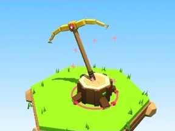 | [Pioche dorée](Pioche%20dor%C3%A9e.md) | Modèle low-poly · 8 × 9 × 6 |
|  | [Pioche en diamant](Pioche%20en%20diamant.md) | Modèle low-poly · 8 × 9 × 6 |
|  | [Hache en fer](Hache%20en%20fer.md) | Modèle low-poly · 6 × 10 × 6 |
|  | [Hache dorée](Hache%20dor%C3%A9e.md) | Modèle low-poly · 6 × 10 × 6 |
| 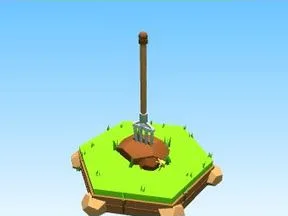 | [Fourche](Fourche.md) | Modèle low-poly · 5 × 10 × 4 |
|  | [Binette](Binette.md) | Modèle low-poly · 5 × 9 × 5 |
|  | [Faucille](Faucille.md) | Modèle low-poly · 5 × 2 × 5 |

Retour : [Rake Vault](../Rake%20Vault.md)
