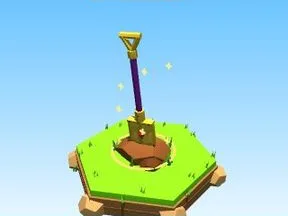

# Pelle dorée

Pelle à poignée en D plantée dans la terre.

- **Catégorie** : [Outils](Outils.md)
- **Type** : Modèle low-poly
- **Taille** : 5 × 10 × 5 studs

## Variantes

- [Pelle en bois](Pelle%20en%20bois.md)
- [Pelle en fer](Pelle%20en%20fer.md)
