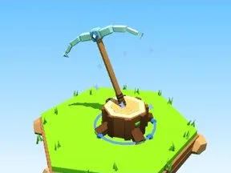

# Pioche en diamant

Pioche plantée dans une souche.

- **Catégorie** : [Outils](Outils.md)
- **Type** : Modèle low-poly
- **Taille** : 8 × 9 × 6 studs

## Variantes

- [Pioche en pierre](Pioche%20en%20pierre.md)
- [Pioche en fer](Pioche%20en%20fer.md)
- [Pioche dorée](Pioche%20dor%C3%A9e.md)
