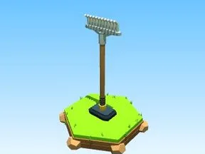

# Râteau en fer

Râteau de jardin : arceaux en acier et 11 dents recourbées.

- **Catégorie** : [Outils](Outils.md)
- **Type** : Modèle low-poly
- **Taille** : 5 × 13 × 2 studs

## Variantes

- [Râteau en bois](R%C3%A2teau%20en%20bois.md)
- [Râteau en pierre](R%C3%A2teau%20en%20pierre.md)
- [Râteau à feuilles rouge](R%C3%A2teau%20%C3%A0%20feuilles%20rouge.md)
- [Râteau doré](R%C3%A2teau%20dor%C3%A9.md)
- [Râteau diamant](R%C3%A2teau%20diamant.md)
- [Râteau émeraude](R%C3%A2teau%20%C3%A9meraude.md)
- [Râteau rubis](R%C3%A2teau%20rubis.md)
- [Râteau de lave](R%C3%A2teau%20de%20lave.md)
- [Râteau de glace](R%C3%A2teau%20de%20glace.md)
- [Râteau du Void](R%C3%A2teau%20du%20Void.md)
- [Râteau arc-en-ciel](R%C3%A2teau%20arc-en-ciel.md)
- [Râteau bonbon](R%C3%A2teau%20bonbon.md)
- [Râteau néon](R%C3%A2teau%20n%C3%A9on.md)
- [Râteau squelette](R%C3%A2teau%20squelette.md)
- [Râteau galaxie](R%C3%A2teau%20galaxie.md)
- [Râteau Brainrot SECRET](R%C3%A2teau%20Brainrot%20SECRET.md)
