# 99 Eggs

Sous-catégorie de [Pets & meshes](../Pets%20%26%20meshes.md) · **100 éléments**

| Aperçu | Élément | Infos |
| --- | --- | --- |
|  | [Alchemist #050](Alchemist%20050.md) | Modèle en MeshParts · 1 MeshPart |
| 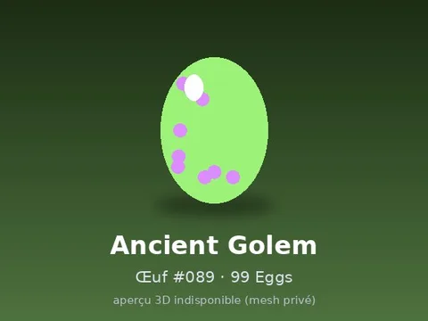 | [Ancient Golem #089](Ancient%20Golem%20089.md) | Modèle en MeshParts · 1 MeshPart |
| 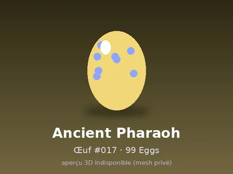 | [Ancient Pharaoh #017](Ancient%20Pharaoh%20017.md) | Modèle en MeshParts · 1 MeshPart |
| 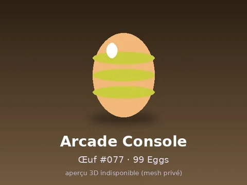 | [Arcade Console #077](Arcade%20Console%20077.md) | Modèle en MeshParts · 1 MeshPart |
| 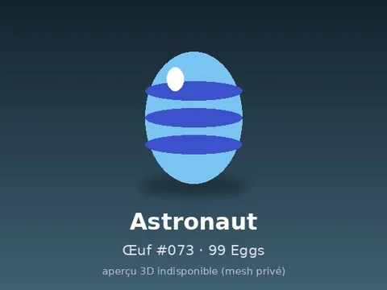 | [Astronaut #073](Astronaut%20073.md) | Modèle en MeshParts · 1 MeshPart |
| 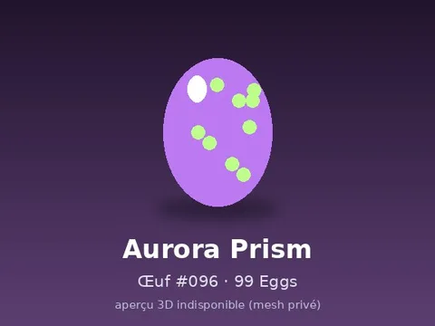 | [Aurora Prism #096](Aurora%20Prism%20096.md) | Modèle en MeshParts · 1 MeshPart |
| 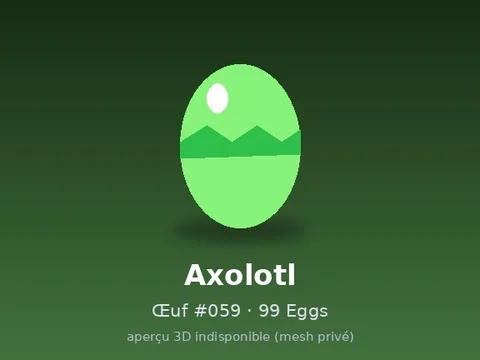 | [Axolotl #059](Axolotl%20059.md) | Modèle en MeshParts · 1 MeshPart |
| 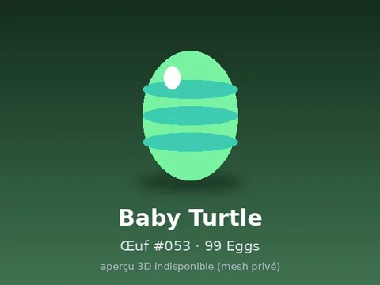 | [Baby Turtle #053](Baby%20Turtle%20053.md) | Modèle en MeshParts · 1 MeshPart |
| 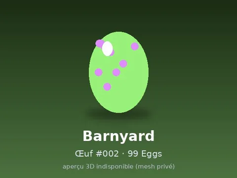 | [Barnyard #002](Barnyard%20002.md) | Modèle en MeshParts · 1 MeshPart |
| 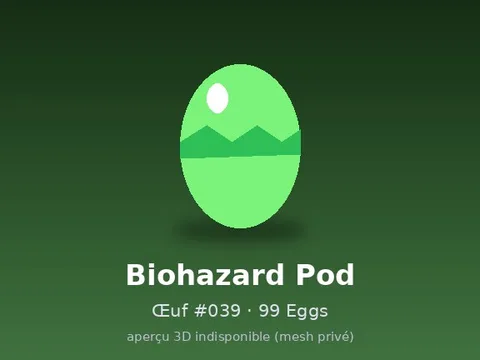 | [Biohazard Pod #039](Biohazard%20Pod%20039.md) | Modèle en MeshParts · 1 MeshPart |
| 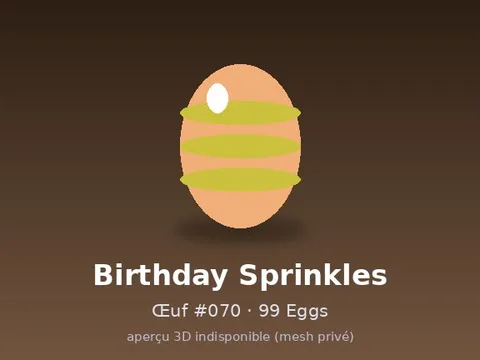 | [Birthday Sprinkles #070](Birthday%20Sprinkles%20070.md) | Modèle en MeshParts · 1 MeshPart |
| 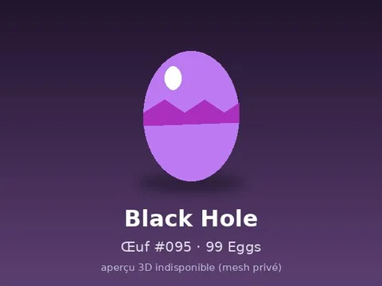 | [Black Hole #095](Black%20Hole%20095.md) | Modèle en MeshParts · 1 MeshPart |
| 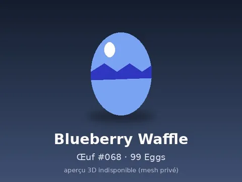 | [Blueberry Waffle #068](Blueberry%20Waffle%20068.md) | Modèle en MeshParts · 1 MeshPart |
| 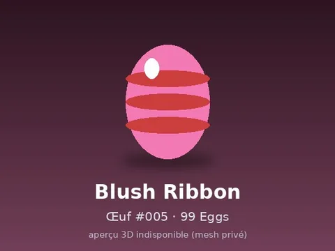 | [Blush Ribbon #005](Blush%20Ribbon%20005.md) | Modèle en MeshParts · 1 MeshPart |
| 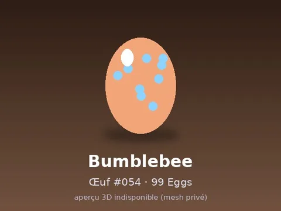 | [Bumblebee #054](Bumblebee%20054.md) | Modèle en MeshParts · 1 MeshPart |
| 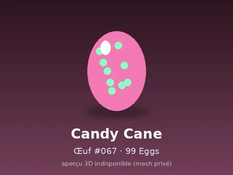 | [Candy Cane #067](Candy%20Cane%20067.md) | Modèle en MeshParts · 1 MeshPart |
| 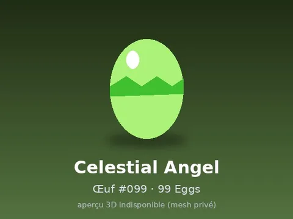 | [Celestial Angel #099](Celestial%20Angel%20099.md) | Modèle en MeshParts · 1 MeshPart |
| 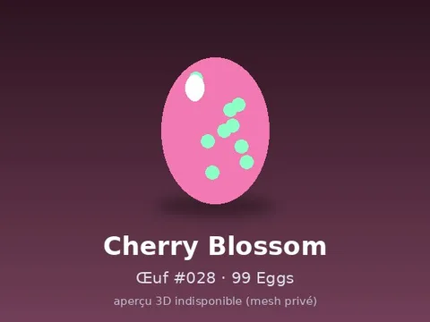 | [Cherry Blossom #028](Cherry%20Blossom%20028.md) | Modèle en MeshParts · 1 MeshPart |
| 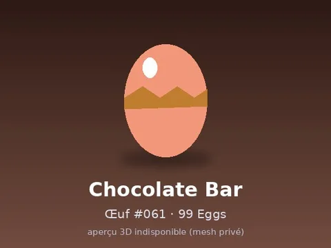 | [Chocolate Bar #061](Chocolate%20Bar%20061.md) | Modèle en MeshParts · 1 MeshPart |
| 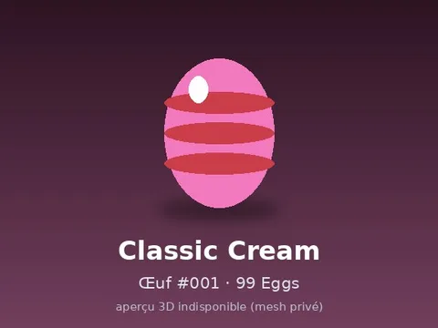 | [Classic Cream #001](Classic%20Cream%20001.md) | Modèle en MeshParts · 1 MeshPart |
| 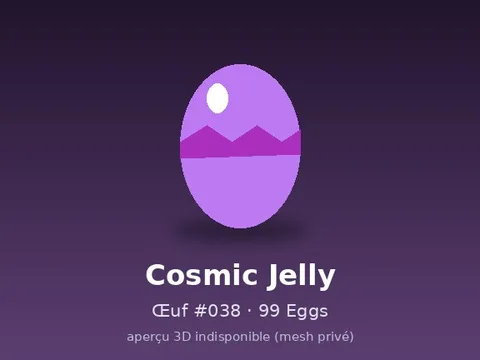 | [Cosmic Jelly #038](Cosmic%20Jelly%20038.md) | Modèle en MeshParts · 1 MeshPart |
| 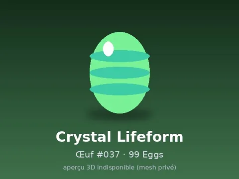 | [Crystal Lifeform #037](Crystal%20Lifeform%20037.md) | Modèle en MeshParts · 1 MeshPart |
| 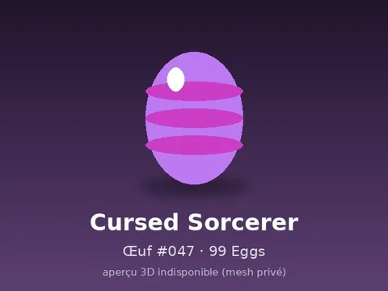 | [Cursed Sorcerer #047](Cursed%20Sorcerer%20047.md) | Modèle en MeshParts · 1 MeshPart |
| 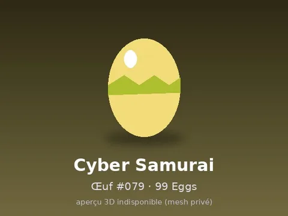 | [Cyber Samurai #079](Cyber%20Samurai%20079.md) | Modèle en MeshParts · 1 MeshPart |
| 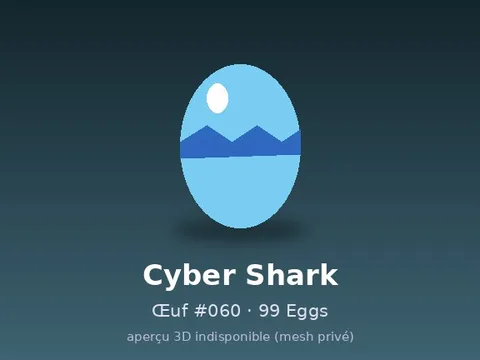 | [Cyber Shark #060](Cyber%20Shark%20060.md) | Modèle en MeshParts · 1 MeshPart |
| 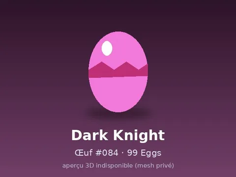 | [Dark Knight #084](Dark%20Knight%20084.md) | Modèle en MeshParts · 1 MeshPart |
| 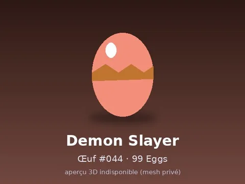 | [Demon Slayer #044](Demon%20Slayer%20044.md) | Modèle en MeshParts · 1 MeshPart |
| 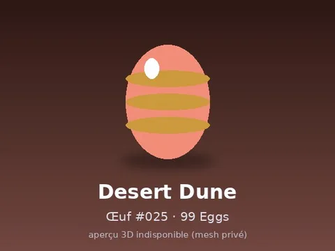 | [Desert Dune #025](Desert%20Dune%20025.md) | Modèle en MeshParts · 1 MeshPart |
| 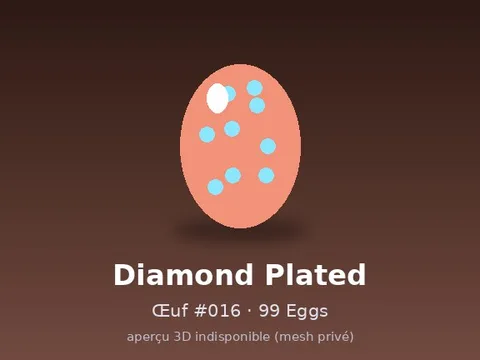 | [Diamond Plated #016](Diamond%20Plated%20016.md) | Modèle en MeshParts · 1 MeshPart |
| 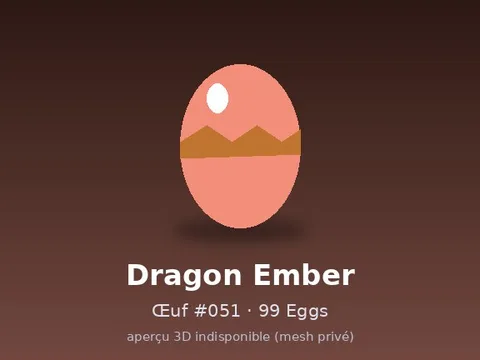 | [Dragon Ember #051](Dragon%20Ember%20051.md) | Modèle en MeshParts · 1 MeshPart |
| 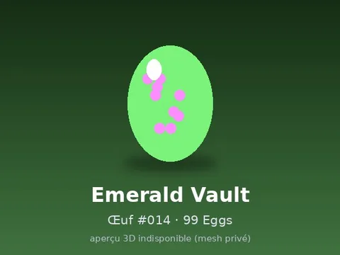 | [Emerald Vault #014](Emerald%20Vault%20014.md) | Modèle en MeshParts · 1 MeshPart |
| 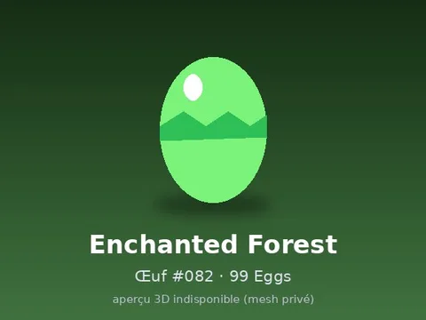 | [Enchanted Forest #082](Enchanted%20Forest%20082.md) | Modèle en MeshParts · 1 MeshPart |
| 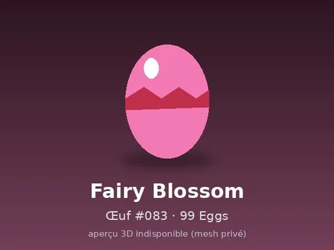 | [Fairy Blossom #083](Fairy%20Blossom%20083.md) | Modèle en MeshParts · 1 MeshPart |
| 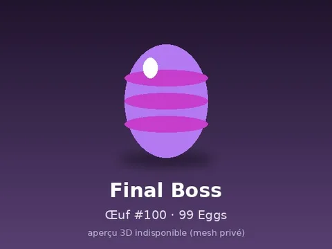 | [Final Boss #100](Final%20Boss%20100.md) | Modèle en MeshParts · 1 MeshPart |
| 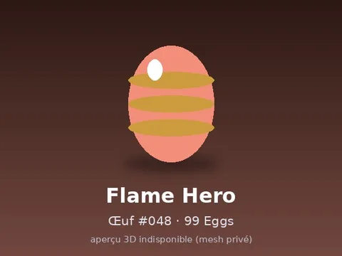 | [Flame Hero #048](Flame%20Hero%20048.md) | Modèle en MeshParts · 1 MeshPart |
| 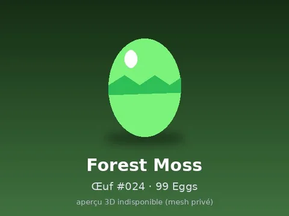 | [Forest Moss #024](Forest%20Moss%20024.md) | Modèle en MeshParts · 1 MeshPart |
| 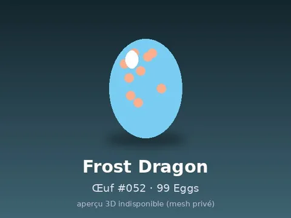 | [Frost Dragon #052](Frost%20Dragon%20052.md) | Modèle en MeshParts · 1 MeshPart |
| 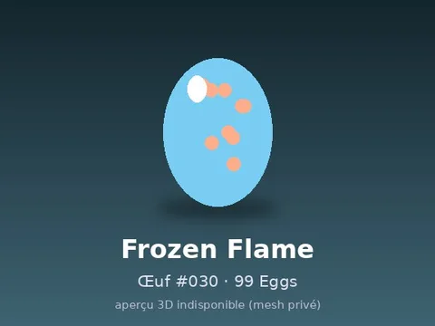 | [Frozen Flame #030](Frozen%20Flame%20030.md) | Modèle en MeshParts · 1 MeshPart |
| 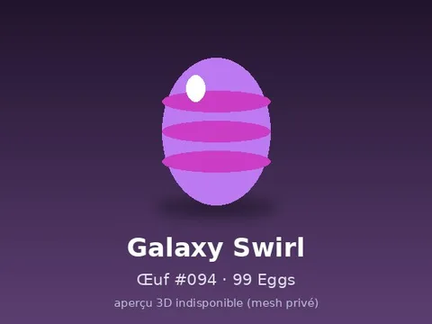 | [Galaxy Swirl #094](Galaxy%20Swirl%20094.md) | Modèle en MeshParts · 1 MeshPart |
| 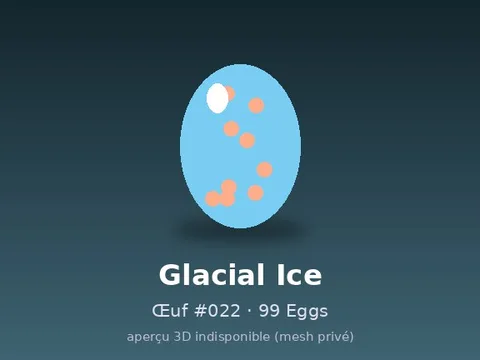 | [Glacial Ice #022](Glacial%20Ice%20022.md) | Modèle en MeshParts · 1 MeshPart |
| 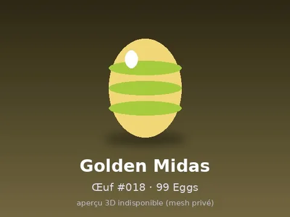 | [Golden Midas #018](Golden%20Midas%20018.md) | Modèle en MeshParts · 1 MeshPart |
| 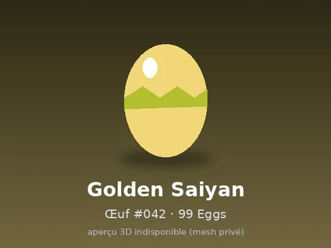 | [Golden Saiyan #042](Golden%20Saiyan%20042.md) | Modèle en MeshParts · 1 MeshPart |
| 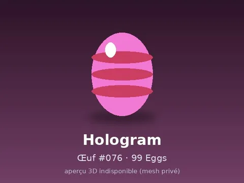 | [Hologram #076](Hologram%20076.md) | Modèle en MeshParts · 1 MeshPart |
|  | [Honeycomb #069](Honeycomb%20069.md) | Modèle en MeshParts · 1 MeshPart |
| 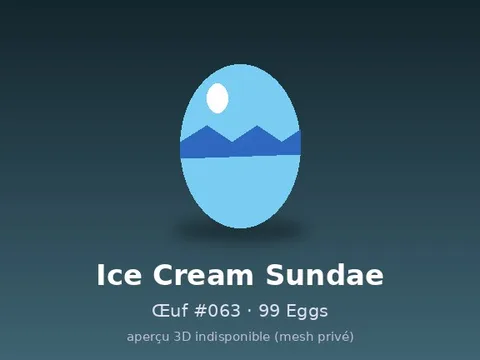 | [Ice Cream Sundae #063](Ice%20Cream%20Sundae%20063.md) | Modèle en MeshParts · 1 MeshPart |
| 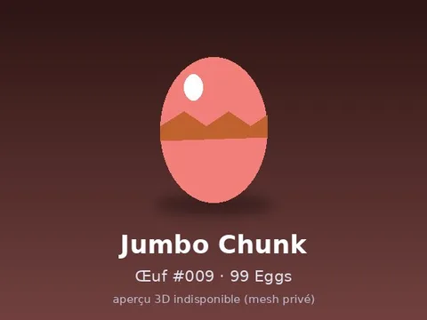 | [Jumbo Chunk #009](Jumbo%20Chunk%20009.md) | Modèle en MeshParts · 1 MeshPart |
| 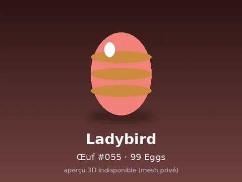 | [Ladybird #055](Ladybird%20055.md) | Modèle en MeshParts · 1 MeshPart |
| 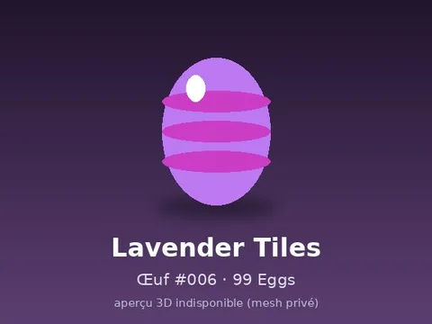 | [Lavender Tiles #006](Lavender%20Tiles%20006.md) | Modèle en MeshParts · 1 MeshPart |
| 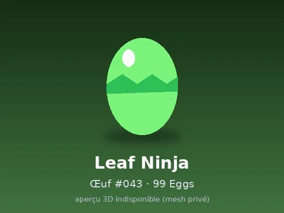 | [Leaf Ninja #043](Leaf%20Ninja%20043.md) | Modèle en MeshParts · 1 MeshPart |
| 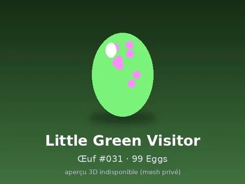 | [Little Green Visitor #031](Little%20Green%20Visitor%20031.md) | Modèle en MeshParts · 1 MeshPart |
| 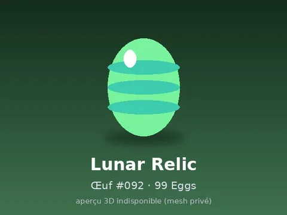 | [Lunar Relic #092](Lunar%20Relic%20092.md) | Modèle en MeshParts · 1 MeshPart |
| 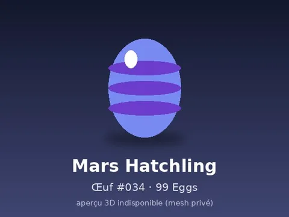 | [Mars Hatchling #034](Mars%20Hatchling%20034.md) | Modèle en MeshParts · 1 MeshPart |
|  | [Mecha Unit #072](Mecha%20Unit%20072.md) | Modèle en MeshParts · 1 MeshPart |
|  | [Mimic Chest #086](Mimic%20Chest%20086.md) | Modèle en MeshParts · 1 MeshPart |
|  | [Mint Chip #004](Mint%20Chip%20004.md) | Modèle en MeshParts · 1 MeshPart |
|  | [Molten Lava #021](Molten%20Lava%20021.md) | Modèle en MeshParts · 1 MeshPart |
|  | [Monochrome #010](Monochrome%20010.md) | Modèle en MeshParts · 1 MeshPart |
|  | [Moon Crawler #040](Moon%20Crawler%20040.md) | Modèle en MeshParts · 1 MeshPart |
|  | [Moon Guardian #049](Moon%20Guardian%20049.md) | Modèle en MeshParts · 1 MeshPart |
|  | [Nebula Parasite #032](Nebula%20Parasite%20032.md) | Modèle en MeshParts · 1 MeshPart |
|  | [Neon Circuit #071](Neon%20Circuit%20071.md) | Modèle en MeshParts · 1 MeshPart |
|  | [Nuclear Reactor #074](Nuclear%20Reactor%20074.md) | Modèle en MeshParts · 1 MeshPart |
|  | [Obsidian Fortune #020](Obsidian%20Fortune%20020.md) | Modèle en MeshParts · 1 MeshPart |
|  | [Ocean Stripe #007](Ocean%20Stripe%20007.md) | Modèle en MeshParts · 1 MeshPart |
|  | [Panda Cub #058](Panda%20Cub%20058.md) | Modèle en MeshParts · 1 MeshPart |
|  | [Phoenix Rebirth #087](Phoenix%20Rebirth%20087.md) | Modèle en MeshParts · 1 MeshPart |
|  | [Pineapple #065](Pineapple%20065.md) | Modèle en MeshParts · 1 MeshPart |
|  | [Pirate Hoard #019](Pirate%20Hoard%20019.md) | Modèle en MeshParts · 1 MeshPart |
|  | [Rainbow Spectrum #098](Rainbow%20Spectrum%20098.md) | Modèle en MeshParts · 1 MeshPart |
|  | [Retro Robot #078](Retro%20Robot%20078.md) | Modèle en MeshParts · 1 MeshPart |
|  | [Robin Blue #003](Robin%20Blue%20003.md) | Modèle en MeshParts · 1 MeshPart |
|  | [Rose Gold #015](Rose%20Gold%20015.md) | Modèle en MeshParts · 1 MeshPart |
|  | [Royal Crown #012](Royal%20Crown%20012.md) | Modèle en MeshParts · 1 MeshPart |
|  | [Royal Paladin #085](Royal%20Paladin%20085.md) | Modèle en MeshParts · 1 MeshPart |
|  | [Saturn Rings #093](Saturn%20Rings%20093.md) | Modèle en MeshParts · 1 MeshPart |
|  | [Snow Owl #056](Snow%20Owl%20056.md) | Modèle en MeshParts · 1 MeshPart |
|  | [Solar Battery #080](Solar%20Battery%20080.md) | Modèle en MeshParts · 1 MeshPart |
|  | [Solar Core #091](Solar%20Core%20091.md) | Modèle en MeshParts · 1 MeshPart |
|  | [Solid Gold #011](Solid%20Gold%20011.md) | Modèle en MeshParts · 1 MeshPart |
|  | [Spirit Reaper #045](Spirit%20Reaper%20045.md) | Modèle en MeshParts · 1 MeshPart |
|  | [Starlight #097](Starlight%20097.md) | Modèle en MeshParts · 1 MeshPart |
|  | [Steampunk #075](Steampunk%20075.md) | Modèle en MeshParts · 1 MeshPart |
|  | [Straw Hat Voyager #041](Straw%20Hat%20Voyager%20041.md) | Modèle en MeshParts · 1 MeshPart |
|  | [Strawberry Cake #062](Strawberry%20Cake%20062.md) | Modèle en MeshParts · 1 MeshPart |
|  | [Sunshine #008](Sunshine%20008.md) | Modèle en MeshParts · 1 MeshPart |
|  | [Sushi Roll #066](Sushi%20Roll%20066.md) | Modèle en MeshParts · 1 MeshPart |
|  | [Thunderstorm #023](Thunderstorm%20023.md) | Modèle en MeshParts · 1 MeshPart |
|  | [Tidal Wave #026](Tidal%20Wave%20026.md) | Modèle en MeshParts · 1 MeshPart |
|  | [Tiger Cub #057](Tiger%20Cub%20057.md) | Modèle en MeshParts · 1 MeshPart |
|  | [Titan Scout #046](Titan%20Scout%20046.md) | Modèle en MeshParts · 1 MeshPart |
|  | [Toxic Slime #029](Toxic%20Slime%20029.md) | Modèle en MeshParts · 1 MeshPart |
|  | [Treasure Chest #013](Treasure%20Chest%20013.md) | Modèle en MeshParts · 1 MeshPart |
|  | [UFO Pilot #033](UFO%20Pilot%20033.md) | Modèle en MeshParts · 1 MeshPart |
|  | [Unicorn Dream #090](Unicorn%20Dream%20090.md) | Modèle en MeshParts · 1 MeshPart |
|  | [Vampire Count #088](Vampire%20Count%20088.md) | Modèle en MeshParts · 1 MeshPart |
|  | [Void Watcher #035](Void%20Watcher%20035.md) | Modèle en MeshParts · 1 MeshPart |
|  | [Volcanic Ash #027](Volcanic%20Ash%20027.md) | Modèle en MeshParts · 1 MeshPart |
|  | [Watermelon #064](Watermelon%20064.md) | Modèle en MeshParts · 1 MeshPart |
|  | [Wizard Apprentice #081](Wizard%20Apprentice%20081.md) | Modèle en MeshParts · 1 MeshPart |
|  | [Xeno Hive #036](Xeno%20Hive%20036.md) | Modèle en MeshParts · 1 MeshPart |
