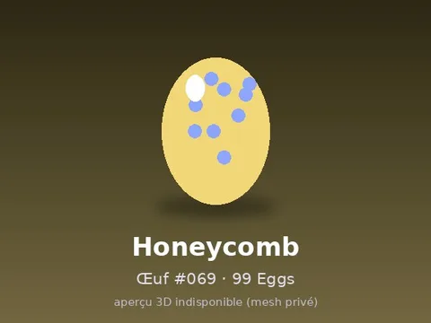

# Honeycomb #069

Modèle en MeshParts « Honeycomb #069 ». Pas d’aperçu 3D : mesh privé du compte LFT_Labs (le .rbxm marche quand même dans Studio connecté avec ce compte).

- **Catégorie** : [Pets & meshes](../Pets%20%26%20meshes.md)
- **Sous-catégorie** : [99 Eggs](99%20Eggs.md)
- **Type** : Modèle en MeshParts
- **Contenu** : 1 MeshPart
- **Pack d'origine** : 99 Eggs (`99_EGGS.rbxl`)
- **Fichier source** : `packs/Eggs_99/069_Honeycomb.rbxm` (export individuel, téléchargeable depuis le vault 3D)
- **Meshes** : privés (compte Roblox LFT_Labs), pas d'aperçu 3D disponible
