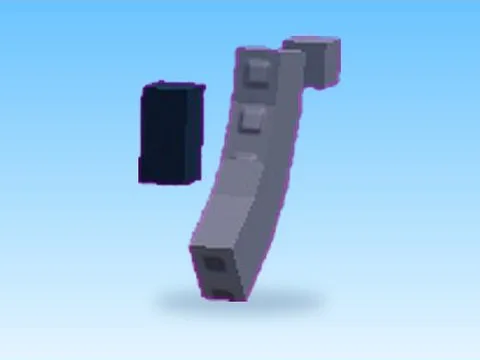

# AK 47 · Billionaire Tycoon

Modèle en MeshParts « AK 47 » (Billionaire Tycoon). Aperçu rendu dans Roblox Studio avec ses vraies textures.

- **Catégorie** : [Pets & meshes](../Pets%20&%20meshes.md)
- **Sous-catégorie** : [Assets de jeux](Assets%20de%20jeux%20%28Pets%20&%20meshes%29.md)
- **Type** : Modèle en MeshParts
- **Contenu** : 6 Parts · 10 MeshParts
- **Jeu d'origine** : Billionaire Tycoon
- **Fichier source** : `models/FromGames/Billionaire_Tycoon/AK-47.rbxm` (dans ta bibliothèque `rblx\lib`)
