# Assets de jeux

Sous-catégorie de [Pets & meshes](../Pets%20%26%20meshes.md) · **36 éléments**

| Aperçu | Élément | Infos |
| --- | --- | --- |
|  | [AK 47 · Billionaire Tycoon](AK%2047%20%C2%B7%20Billionaire%20Tycoon.md) | Modèle en MeshParts · 6 Parts · 10 MeshParts |
| 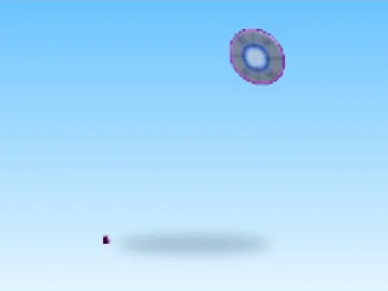 | [Alien Invasion · Bakery Simulator](Alien%20Invasion%20%C2%B7%20Bakery%20Simulator.md) | Modèle en MeshParts · 5 MeshParts |
| 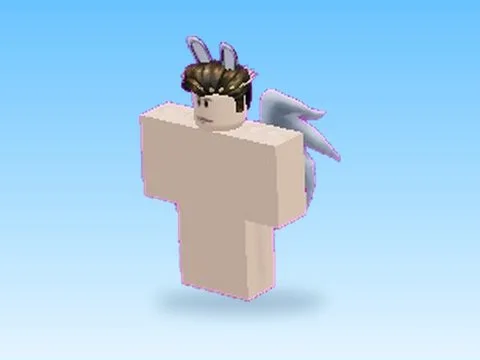 | [Already Pro · Mining Masters](Already%20Pro%20%C2%B7%20Mining%20Masters.md) | Modèle en MeshParts · 6 Parts · 3 MeshParts |
| 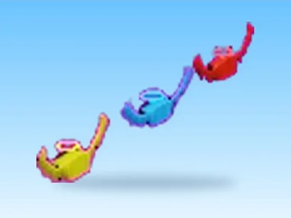 | [Angelic Button · Tapping Lords](Angelic%20Button%20%C2%B7%20Tapping%20Lords.md) | Modèle en MeshParts · 6 Parts · 10 MeshParts |
| 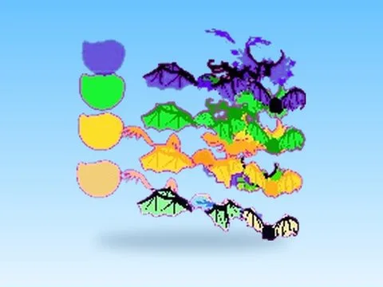 | [Assets · Rebirth Champions X](Assets%20%C2%B7%20Rebirth%20Champions%20X.md) | Modèle en MeshParts · 79 Parts · 6 831 MeshParts |
| 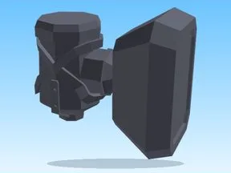 | [Assets · Robot Simulator](Assets%20%C2%B7%20Robot%20Simulator.md) | Modèle en MeshParts · 546 MeshParts |
| 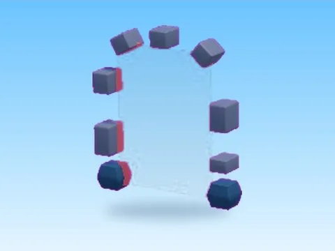 | [Back Portal · Glass Bridge](Back%20Portal%20%C2%B7%20Glass%20Bridge.md) | Modèle en MeshParts · 1 Part · 15 MeshParts |
| 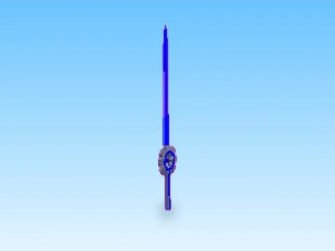 | [Cog Blade · Robot Simulator](Cog%20Blade%20%C2%B7%20Robot%20Simulator.md) | Modèle en MeshParts · 9 MeshParts |
| 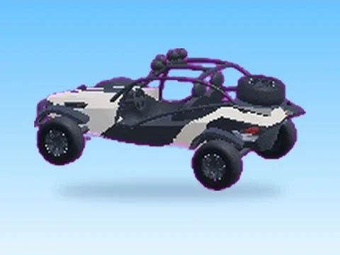 | [Dune Buggy beige · First Donations](Dune%20Buggy%20beige%20%C2%B7%20First%20Donations.md) | Modèle en MeshParts · 18 Parts · 23 MeshParts |
| 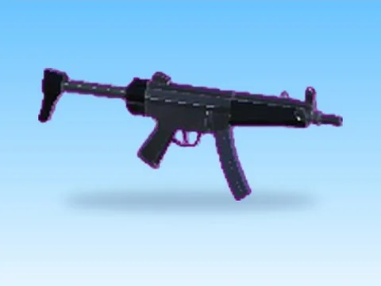 | [GUNS SMG · First Donations](GUNS%20SMG%20%C2%B7%20First%20Donations.md) | Modèle en MeshParts · 2 MeshParts |
|  | [Guest · Pet Pharmica](Guest%20%C2%B7%20Pet%20Pharmica.md) | Modèle en MeshParts · 3 MeshParts |
|  | [Helicopter · Glass Bridge](Helicopter%20%C2%B7%20Glass%20Bridge.md) | Modèle en MeshParts · 2 Parts · 5 MeshParts |
| 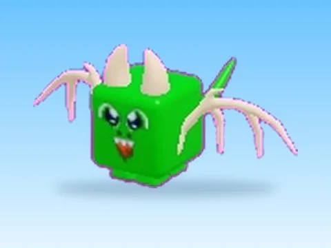 | [Huge Dragon · Mining Masters](Huge%20Dragon%20%C2%B7%20Mining%20Masters.md) | Modèle en MeshParts · 12 MeshParts |
| 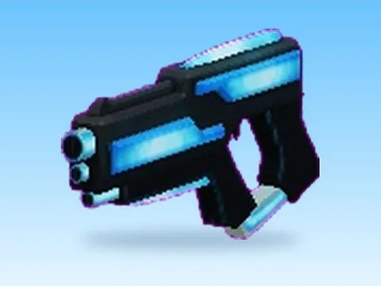 | [Hyperlaser Gun · Billionaire Tycoon](Hyperlaser%20Gun%20%C2%B7%20Billionaire%20Tycoon.md) | Modèle en MeshParts · 1 MeshPart |
|  | [Low Mode Parts · Robot Simulator](Low%20Mode%20Parts%20%C2%B7%20Robot%20Simulator.md) | Modèle en MeshParts · 61 Parts · 39 MeshParts |
|  | [Melody · First Donations](Melody%20%C2%B7%20First%20Donations.md) | Modèle en MeshParts · 17 MeshParts |
| 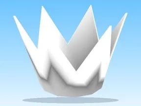 | [Modules · Robot Simulator](Modules%20%C2%B7%20Robot%20Simulator.md) | Modèle en MeshParts · 4 Parts · 2 MeshParts |
| 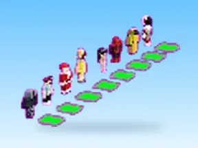 | [Morphs · Glass Bridge](Morphs%20%C2%B7%20Glass%20Bridge.md) | Modèle en MeshParts · 38 Parts · 60 MeshParts |
| 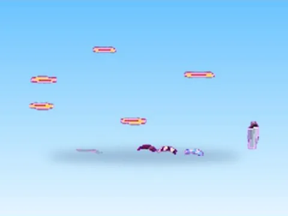 | [OLD THINGS · Robot Simulator](OLD%20THINGS%20%C2%B7%20Robot%20Simulator.md) | Modèle en MeshParts · 330 Parts · 46 MeshParts |
| 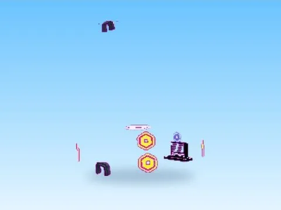 | [Party · First Donations](Party%20%C2%B7%20First%20Donations.md) | Modèle en MeshParts · 61 Parts · 115 MeshParts |
| 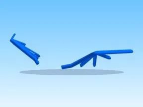 | [Pets · Robot Simulator](Pets%20%C2%B7%20Robot%20Simulator%20%C2%B7%20Assets%20de%20jeux.md) | Modèle en MeshParts · 59 Parts · 910 MeshParts |
| 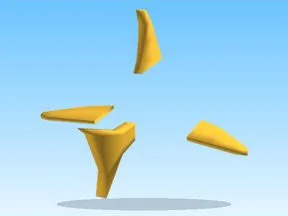 | [Pets · Tapping Lords](Pets%20%C2%B7%20Tapping%20Lords.md) | Modèle en MeshParts · 33 Parts · 1 317 MeshParts |
|  | [Pets · Training Simulator](Pets%20%C2%B7%20Training%20Simulator%20%C2%B7%20Assets%20de%20jeux.md) | Modèle en MeshParts · 595 MeshParts |
|  | [Pickaxe · Mining Masters](Pickaxe%20%C2%B7%20Mining%20Masters.md) | Modèle en MeshParts · 3 MeshParts |
|  | [Portals · Tapping Lords](Portals%20%C2%B7%20Tapping%20Lords.md) | Modèle en MeshParts · 96 Parts · 13 MeshParts |
| 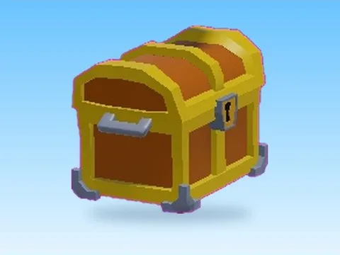 | [Reward Chest · Cashgrab Bridge](Reward%20Chest%20%C2%B7%20Cashgrab%20Bridge.md) | Modèle en MeshParts · 1 Part · 6 MeshParts |
| 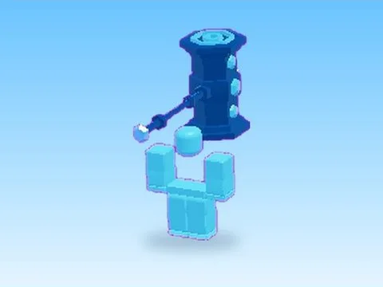 | [Robux Hammer Giant · First Donations](Robux%20Hammer%20Giant%20%C2%B7%20First%20Donations.md) | Modèle en MeshParts · 2 Parts · 17 MeshParts |
| 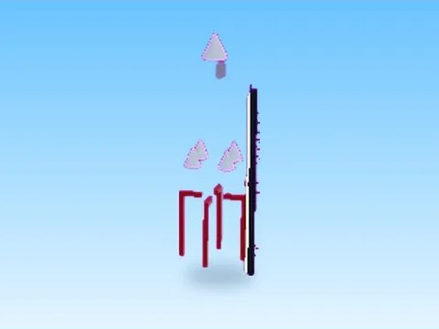 | [Rocket · Robot Simulator](Rocket%20%C2%B7%20Robot%20Simulator.md) | Modèle en MeshParts · 838 Parts · 21 MeshParts |
| 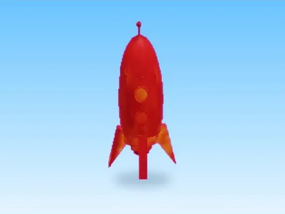 | [Rocket L · First Donations](Rocket%20L%20%C2%B7%20First%20Donations.md) | Modèle en MeshParts · 1 MeshPart |
| 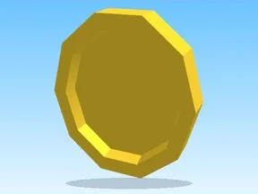 | [Sells · Robot Simulator](Sells%20%C2%B7%20Robot%20Simulator.md) | Modèle en MeshParts · 15 Parts · 26 MeshParts |
| 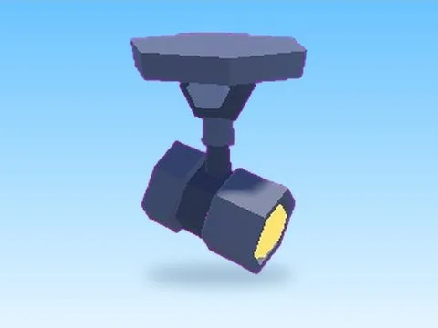 | [Spotlight · First Donations](Spotlight%20%C2%B7%20First%20Donations.md) | Modèle en MeshParts · 8 MeshParts |
|  | [Stands · First Donations](Stands%20%C2%B7%20First%20Donations.md) | Modèle en MeshParts · 448 MeshParts |
| 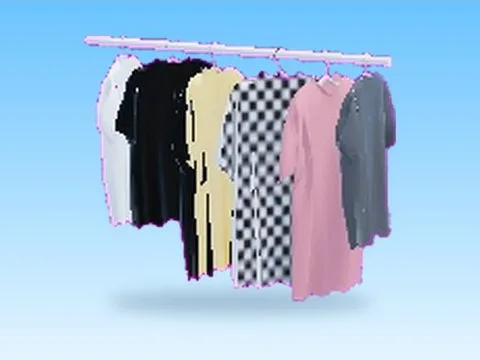 | [Superbiz Catalog Model · +1 Jump Every Second](Superbiz%20Catalog%20Model%20%C2%B7%20%2B1%20Jump%20Every%20Second.md) | Modèle en MeshParts · 1 Part · 8 MeshParts |
|  | [Templates · First Donations](Templates%20%C2%B7%20First%20Donations.md) | Modèle en MeshParts · 7 MeshParts |
| 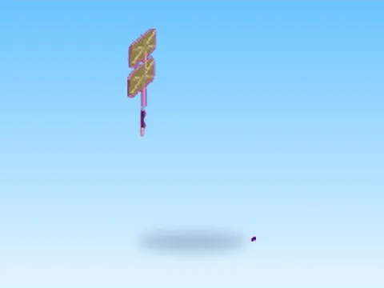 | [Tools · First Donations](Tools%20%C2%B7%20First%20Donations.md) | Modèle en MeshParts · 7 MeshParts |
|  | [Youtube Star · Tapping Lords](Youtube%20Star%20%C2%B7%20Tapping%20Lords.md) | Modèle en MeshParts · 3 MeshParts |
