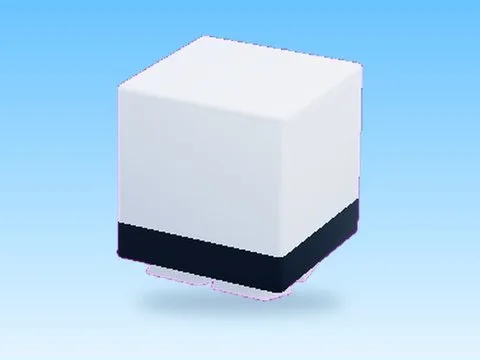

# Guest · Pet Pharmica

Modèle en MeshParts « Guest » (Pet Pharmica). Aperçu rendu dans Roblox Studio avec ses vraies textures.

- **Catégorie** : [Pets & meshes](../Pets%20&%20meshes.md)
- **Sous-catégorie** : [Assets de jeux](Assets%20de%20jeux%20%28Pets%20&%20meshes%29.md)
- **Type** : Modèle en MeshParts
- **Contenu** : 3 MeshParts
- **Jeu d'origine** : Pet Pharmica
- **Fichier source** : `Assets/models/FromGames/Pet_Pharmica_1_1/Workspace/Guest.rbxm` (dans le vault)
