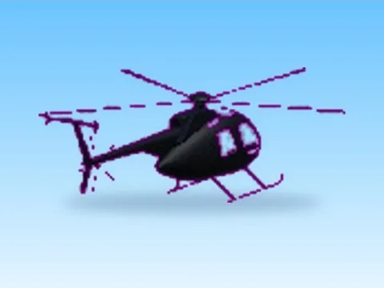

# Helicopter · Glass Bridge

Modèle en MeshParts « Helicopter » (Glass Bridge). Aperçu rendu dans Roblox Studio avec ses vraies textures.

- **Catégorie** : [Pets & meshes](../Pets%20&%20meshes.md)
- **Sous-catégorie** : [Assets de jeux](Assets%20de%20jeux%20%28Pets%20&%20meshes%29.md)
- **Type** : Modèle en MeshParts
- **Contenu** : 2 Parts · 5 MeshParts
- **Jeu d'origine** : Glass Bridge
- **Fichier source** : `models/FromGames/GlassBridge/Helicopter.rbxm` (dans ta bibliothèque `rblx\lib`)
