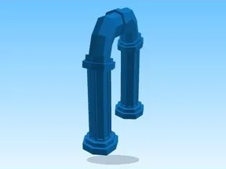

# Portals · Tapping Lords

Modèle en MeshParts « Portals » (Tapping Lords). Aperçu : forme du mesh principal (sans texture).

- **Catégorie** : [Pets & meshes](../Pets%20&%20meshes.md)
- **Sous-catégorie** : [Assets de jeux](Assets%20de%20jeux%20%28Pets%20&%20meshes%29.md)
- **Type** : Modèle en MeshParts
- **Contenu** : 96 Parts · 13 MeshParts
- **Jeu d'origine** : Tapping Lords
- **Fichier source** : `Assets/models/FromGames/Tapping-Lords-Simulator/Workspace/Portals.rbxm` (dans le vault)
