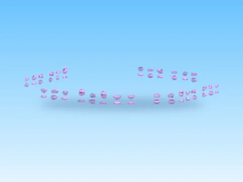

# Stands · First Donations

Modèle en MeshParts « Stands » (First Donations). Aperçu rendu dans Roblox Studio avec ses vraies textures.

- **Catégorie** : [Pets & meshes](../Pets%20%26%20meshes.md)
- **Sous-catégorie** : [Assets de jeux](Assets%20de%20jeux%20%28Pets%20%26%20meshes%29.md)
- **Type** : Modèle en MeshParts
- **Contenu** : 448 MeshParts
- **Jeu d'origine** : First Donations
- **Fichier source** : `models/FromGames/First_Donations/Workspace/Stands.rbxm` (dans ta bibliothèque `rblx\lib`)
