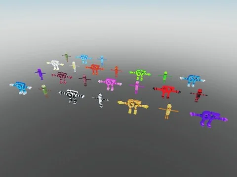

# All Brainrots Models With All Mutations (fayplestudios)

Pack fayplestudios : environ 453 modèles de brainrots déclinés dans 12 mutations (Default, Gold, Diamond, Rainbow, Galaxy, Lava, Candy, Cursed, Divine, Bloodrot, Radioactive, YinYang).

- **Catégorie** : [Pets & meshes](../Pets%20&%20meshes.md)
- **Sous-catégorie** : [Brainrots animés](Brainrots%20anim%C3%A9s.md)
- **Type** : Pack de fichiers
- **Contenu** : 13 fichiers · 31,4 Mo
- **Jeu d'origine** : Steal a Brainrot
- **Fichier source** : `Assets/packs/All Brainrots Models With All Mutations` (dans le vault)

## Fichiers (13)

- `ALL BRAINROTS MODELS WITH ALL MUTATIONS.rbxm`
- `Bloodrot.rbxm`
- `Candy.rbxm`
- `Cursed.rbxm`
- `Default.rbxm`
- `Diamond.rbxm`
- `Divine.rbxm`
- `Galaxy.rbxm`
- `Gold.rbxm`
- `Lava.rbxm`
- `Radioactive.rbxm`
- `Rainbow.rbxm`
- `YinYang.rbxm`
