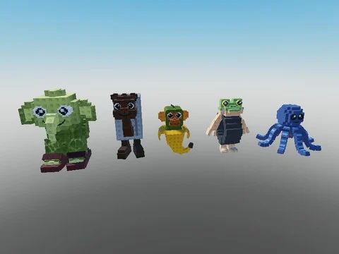

# Baby Brainrots (11 modèles)

11 modèles de baby brainrots (Baby Tung Tung Sahur, Baby Tralalero Tralala, Baby Lirili Larila, Baby Boneca Ambalabu…).

- **Catégorie** : [Pets & meshes](../Pets%20&%20meshes.md)
- **Sous-catégorie** : [Brainrots animés](Brainrots%20anim%C3%A9s.md)
- **Type** : Pack de fichiers
- **Contenu** : 12 fichiers · 0,2 Mo
- **Jeu d'origine** : Steal a Brainrot
- **Fichier source** : `Assets/packs/Baby Brainrots` (dans le vault)

## Fichiers (12)

- `Baby_Brainrot_Model.rbxm`
- `Baby Blueberrinni Octopusini.rbxm`
- `Baby Boneca Ambalabu.rbxm`
- `Baby Chimpanzini Bananini.rbxm`
- `Baby Frigo Camelo.rbxm`
- `Baby Lirili Larila.rbxm`
- `Baby Orcalero Orcala.rbxm`
- `Baby Pr Pr Patapim.rbxm`
- `Baby Tralalero Tralala.rbxm`
- `Baby Trut Trat Trit.rbxm`
- `Baby Tung Tung Sahur.rbxm`
- `Baby Yess My Examine.rbxm`
