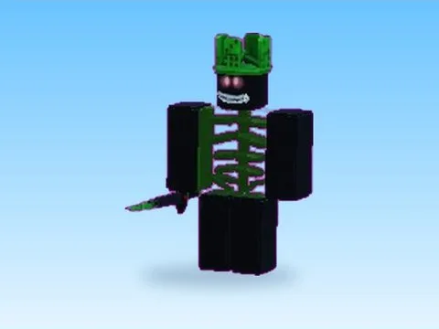

# Brainrots animés — packs complets par variante

Un fichier .rbxm par variante entière (Arcoiris, Diamante, Galaxia, Hacker, Lava, Normal, Oro), pratique pour tout insérer d’un coup dans Studio.

- **Catégorie** : [Pets & meshes](../Pets%20&%20meshes.md)
- **Sous-catégorie** : [Brainrots animés](Brainrots%20anim%C3%A9s.md)
- **Type** : Pack de fichiers
- **Contenu** : 7 fichiers · 0,7 Mo
- **Fichier source** : `Assets/packs/Brainrots_Animated/_Complets` (dans le vault)

## Fichiers (7)

- `Arcoiris_Complet.rbxm`
- `Diamante_Complet.rbxm`
- `Galaxia_Complet.rbxm`
- `Hacker_Complet.rbxm`
- `Lava_Complet.rbxm`
- `Normal_Complet.rbxm`
- `Oro_Complet.rbxm`
