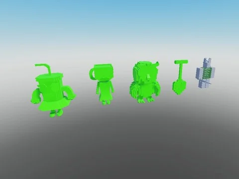

# Brainrots animés — variante Arcoiris (87)

87 brainrots animés (AnimationController + animations) en variante Arcoiris (arc-en-ciel), extraits de Steal an Spooky Egg.

- **Catégorie** : [Pets & meshes](../Pets%20&%20meshes.md)
- **Sous-catégorie** : [Brainrots animés](Brainrots%20anim%C3%A9s.md)
- **Type** : Pack de fichiers
- **Contenu** : 87 fichiers · 0,9 Mo
- **Fichier source** : `Assets/packs/Brainrots_Animated/Arcoiris` (dans le vault)

## Fichiers (87)

- `Rainbow 1x1x1x1.rbxm`
- `Rainbow Agarrini La Pallini.rbxm`
- `Rainbow Avocadini Guffo.rbxm`
- `Rainbow Ballerina Cappuccina.rbxm`
- `Rainbow Ballerino Lololo.rbxm`
- `Rainbow Bambini Crostini.rbxm`
- `Rainbow Banana Dancana.rbxm`
- `Rainbow Bananini Kittini.rbxm`
- `Rainbow Bananita Dolphinita.rbxm`
- `Rainbow Blueberrinni Octopusini.rbxm`
- `Rainbow Bobrito Bandito.rbxm`
- `Rainbow Bombardiro Crocodilo.rbxm`
- `Rainbow Bombombini Gusini.rbxm`
- `Rainbow Boneca Ambalabu.rbxm`
- `Rainbow Brr Brr Patapim.rbxm`
- `Rainbow Brri Brri Bicus Dicus.rbxm`
- `Rainbow Burbaloni Luliloli.rbxm`
- `Rainbow Cachorrito Melonito.rbxm`
- `Rainbow Cacto Hipopotamo.rbxm`
- `Rainbow Cappuccino Assassino.rbxm`
- `Rainbow Cavallo Virtuoso.rbxm`
- `Rainbow Chef Crabracadabra.rbxm`
- `Rainbow Chicleteira Bicicleteira.rbxm`
- `Rainbow Chicleteirina Bicicleteirina.rbxm`
- `Rainbow Chillin Chili.rbxm`
- `Rainbow Chimpanzini Bananini.rbxm`
- `Rainbow Cocofanto Elefanto.rbxm`
- `Rainbow Dragon Cannelloni.rbxm`
- `Rainbow Esok Sekolah.rbxm`
- `Rainbow Espresso Signora.rbxm`
- `Rainbow Fluri Flura.rbxm`
- `Rainbow Frigo Camelo.rbxm`
- `Rainbow Ganganzelli Trulala.rbxm`
- `Rainbow Gangster Footera.rbxm`
- `Rainbow Garamararam.rbxm`
- `Rainbow Girafa Celeste.rbxm`
- `Rainbow Glorbo Fruttodrillo.rbxm`
- `Rainbow Gorillo Watermelondrillo.rbxm`
- `Rainbow Illuminato Triangolo.rbxm`
- `Rainbow Job Job Job Sahur.rbxm`
- `Rainbow Karkerkar Kurkur.rbxm`
- `Rainbow La Grande Combinasion.rbxm`
- `Rainbow La Vacca Saturno Saturnita.rbxm`
- `Rainbow Lerulerulerule.rbxm`
- `Rainbow Lionel Cactuseli.rbxm`
- `Rainbow Lirili Larila.rbxm`
- `Rainbow Los Tralaleritos.rbxm`
- `Rainbow Madudung.rbxm`
- `Rainbow Matteo.rbxm`
- `Rainbow Meowl.rbxm`
- `Rainbow Noo My Examen.rbxm`
- `Rainbow Nyannini Cattalini.rbxm`
- `Rainbow Odin Din Din Dun.rbxm`
- `Rainbow Orangutini Ananassini.rbxm`
- `Rainbow Orcalero Orcala.rbxm`
- `Rainbow Pakrahmatmamat.rbxm`
- `Rainbow Pakrahmatmatina.rbxm`
- `Rainbow Pandaccini Bananini.rbxm`
- `Rainbow Pipi Kiwi.rbxm`
- `Rainbow Pipi Potato.rbxm`
- `Rainbow Pot Hotspot.rbxm`
- `Rainbow Quesadilla Crocodila.rbxm`
- `Rainbow Rhino Toasterino.rbxm`
- `Rainbow Six Seven.rbxm`
- `Rainbow Smurfo Gatto.rbxm`
- `Rainbow Strawberrelli Flamingelli.rbxm`
- `Rainbow Strawberry Elephant.rbxm`
- `Rainbow Svinina Bombardino.rbxm`
- `Rainbow Swag Soda.rbxm`
- `Rainbow Ta Ta Ta Ta Sahur.rbxm`
- `Rainbow Talpa Di Fero.rbxm`
- `Rainbow Tigroligre Frutonni.rbxm`
- `Rainbow Tim Cheese.rbxm`
- `Rainbow Tirilikalika Tirilikalako.rbxm`
- `Rainbow Torrtuginni Dragonfrutini.rbxm`
- `Rainbow Tralaledon.rbxm`
- `Rainbow Tralalero Tralala.rbxm`
- `Rainbow Tralalita Tralala.rbxm`
- `Rainbow Tric Trac Barabum.rbxm`
- `Rainbow Triplito Tralaleritos.rbxm`
- `Rainbow Trippi Troppi Troppa Trippa.rbxm`
- `Rainbow Trippi Troppi.rbxm`
- `Rainbow Trulimero Trulicina.rbxm`
- `Rainbow Tung Sahur.rbxm`
- `Rainbow W Or L.rbxm`
- `Rainbow Yess My Examen.rbxm`
- `Rainbow Zibra Zubra Zibralini.rbxm`
