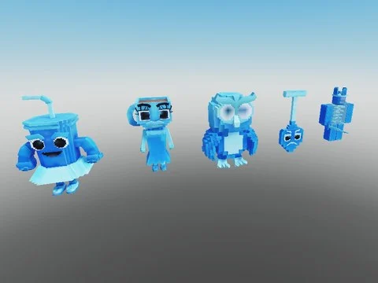

# Brainrots animés — variante Diamante (87)

87 brainrots animés (AnimationController + animations) en variante Diamante (diamant), extraits de Steal an Spooky Egg.

- **Catégorie** : [Pets & meshes](../Pets%20&%20meshes.md)
- **Sous-catégorie** : [Brainrots animés](Brainrots%20anim%C3%A9s.md)
- **Type** : Pack de fichiers
- **Contenu** : 87 fichiers · 0,8 Mo
- **Fichier source** : `Assets/packs/Brainrots_Animated/Diamante` (dans le vault)

## Fichiers (87)

- `Diamond 1x1x1x1.rbxm`
- `Diamond Agarrini La Pallini.rbxm`
- `Diamond Avocadini Guffo.rbxm`
- `Diamond Ballerina Cappuccina.rbxm`
- `Diamond Ballerino Lololo.rbxm`
- `Diamond Bambini Crostini.rbxm`
- `Diamond Banana Dancana.rbxm`
- `Diamond Bananini Kittini.rbxm`
- `Diamond Bananita Dolphinita.rbxm`
- `Diamond Blueberrinni Octopusini.rbxm`
- `Diamond Bobrito Bandito.rbxm`
- `Diamond Bombardiro Crocodilo.rbxm`
- `Diamond Bombombini Gusini.rbxm`
- `Diamond Boneca Ambalabu.rbxm`
- `Diamond Brr Brr Patapim.rbxm`
- `Diamond Brri Brri Bicus Dicus.rbxm`
- `Diamond Burbaloni Luliloli.rbxm`
- `Diamond Cachorrito Melonito.rbxm`
- `Diamond Cacto Hipopotamo.rbxm`
- `Diamond Cappuccino Assassino.rbxm`
- `Diamond Cavallo Virtuoso.rbxm`
- `Diamond Chef Crabracadabra.rbxm`
- `Diamond Chicleteira Bicicleteira.rbxm`
- `Diamond Chicleteirina Bicicleteirina.rbxm`
- `Diamond Chillin Chili.rbxm`
- `Diamond Chimpanzini Bananini.rbxm`
- `Diamond Cocofanto Elefanto.rbxm`
- `Diamond Dragon Cannelloni.rbxm`
- `Diamond Esok Sekolah.rbxm`
- `Diamond Espresso Signora.rbxm`
- `Diamond Fluri Flura.rbxm`
- `Diamond Frigo Camelo.rbxm`
- `Diamond Ganganzelli Trulala.rbxm`
- `Diamond Gangster Footera.rbxm`
- `Diamond Garamararam.rbxm`
- `Diamond Girafa Celeste.rbxm`
- `Diamond Glorbo Fruttodrillo.rbxm`
- `Diamond Gorillo Watermelondrillo.rbxm`
- `Diamond Illuminato Triangolo.rbxm`
- `Diamond Job Job Job Sahur.rbxm`
- `Diamond Karkerkar Kurkur.rbxm`
- `Diamond La Grande Combinasion.rbxm`
- `Diamond La Vacca Saturno Saturnita.rbxm`
- `Diamond Lerulerulerule.rbxm`
- `Diamond Lionel Cactuseli.rbxm`
- `Diamond Lirili Larila.rbxm`
- `Diamond Los Tralaleritos.rbxm`
- `Diamond Madudung.rbxm`
- `Diamond Matteo.rbxm`
- `Diamond Meowl.rbxm`
- `Diamond Noo My Examen.rbxm`
- `Diamond Nyannini Cattalini.rbxm`
- `Diamond Odin Din Din Dun.rbxm`
- `Diamond Orangutini Ananassini.rbxm`
- `Diamond Orcalero Orcala.rbxm`
- `Diamond Pakrahmatmamat.rbxm`
- `Diamond Pakrahmatmatina.rbxm`
- `Diamond Pandaccini Bananini.rbxm`
- `Diamond Pipi Kiwi.rbxm`
- `Diamond Pipi Potato.rbxm`
- `Diamond Pot Hotspot.rbxm`
- `Diamond Quesadilla Crocodila.rbxm`
- `Diamond Rhino Toasterino.rbxm`
- `Diamond Six Seven.rbxm`
- `Diamond Smurfo Gatto.rbxm`
- `Diamond Strawberrelli Flamingelli.rbxm`
- `Diamond Strawberry Elephant.rbxm`
- `Diamond Svinina Bombardino.rbxm`
- `Diamond Swag Soda.rbxm`
- `Diamond Ta Ta Ta Ta Sahur.rbxm`
- `Diamond Talpa Di Fero.rbxm`
- `Diamond Tigroligre Frutonni.rbxm`
- `Diamond Tim Cheese.rbxm`
- `Diamond Tirilikalika Tirilikalako.rbxm`
- `Diamond Torrtuginni Dragonfrutini.rbxm`
- `Diamond Tralaledon.rbxm`
- `Diamond Tralalero Tralala.rbxm`
- `Diamond Tralalita Tralala.rbxm`
- `Diamond Tric Trac Barabum.rbxm`
- `Diamond Triplito Tralaleritos.rbxm`
- `Diamond Trippi Troppi Troppa Trippa.rbxm`
- `Diamond Trippi Troppi.rbxm`
- `Diamond Trulimero Trulicina.rbxm`
- `Diamond Tung Sahur.rbxm`
- `Diamond W Or L.rbxm`
- `Diamond Yess My Examen.rbxm`
- `Diamond Zibra Zubra Zibralini.rbxm`
