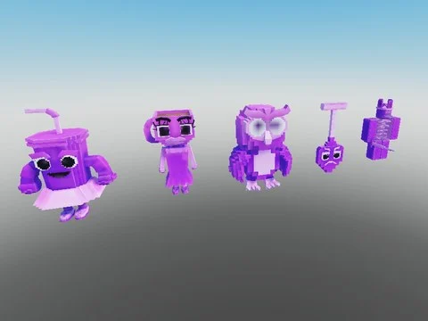

# Brainrots animés — variante Galaxia (87)

87 brainrots animés (AnimationController + animations) en variante Galaxia (galaxie), extraits de Steal an Spooky Egg.

- **Catégorie** : [Pets & meshes](../Pets%20&%20meshes.md)
- **Sous-catégorie** : [Brainrots animés](Brainrots%20anim%C3%A9s.md)
- **Type** : Pack de fichiers
- **Contenu** : 87 fichiers · 1,0 Mo
- **Fichier source** : `Assets/packs/Brainrots_Animated/Galaxia` (dans le vault)

## Fichiers (87)

- `Galaxy 1x1x1x1.rbxm`
- `Galaxy Agarrini La Pallini.rbxm`
- `Galaxy Avocadini Guffo.rbxm`
- `Galaxy Ballerina Cappuccina.rbxm`
- `Galaxy Ballerino Lololo.rbxm`
- `Galaxy Bambini Crostini.rbxm`
- `Galaxy Banana Dancana.rbxm`
- `Galaxy Bananini Kittini.rbxm`
- `Galaxy Bananita Dolphinita.rbxm`
- `Galaxy Blueberrinni Octopusini.rbxm`
- `Galaxy Bobrito Bandito.rbxm`
- `Galaxy Bombardiro Crocodilo.rbxm`
- `Galaxy Bombombini Gusini.rbxm`
- `Galaxy Boneca Ambalabu.rbxm`
- `Galaxy Brr Brr Patapim.rbxm`
- `Galaxy Brri Brri Bicus Dicus.rbxm`
- `Galaxy Burbaloni Luliloli.rbxm`
- `Galaxy Cachorrito Melonito.rbxm`
- `Galaxy Cacto Hipopotamo.rbxm`
- `Galaxy Cappuccino Assassino.rbxm`
- `Galaxy Cavallo Virtuoso.rbxm`
- `Galaxy Chef Crabracadabra.rbxm`
- `Galaxy Chicleteira Bicicleteira.rbxm`
- `Galaxy Chicleteirina Bicicleteirina.rbxm`
- `Galaxy Chillin Chili.rbxm`
- `Galaxy Chimpanzini Bananini.rbxm`
- `Galaxy Cocofanto Elefanto.rbxm`
- `Galaxy Dragon Cannelloni.rbxm`
- `Galaxy Esok Sekolah.rbxm`
- `Galaxy Espresso Signora.rbxm`
- `Galaxy Fluri Flura.rbxm`
- `Galaxy Frigo Camelo.rbxm`
- `Galaxy Ganganzelli Trulala.rbxm`
- `Galaxy Gangster Footera.rbxm`
- `Galaxy Garamararam.rbxm`
- `Galaxy Girafa Celeste.rbxm`
- `Galaxy Glorbo Fruttodrillo.rbxm`
- `Galaxy Gorillo Watermelondrillo.rbxm`
- `Galaxy Illuminato Triangolo.rbxm`
- `Galaxy Job Job Job Sahur.rbxm`
- `Galaxy Karkerkar Kurkur.rbxm`
- `Galaxy La Grande Combinasion.rbxm`
- `Galaxy La Vacca Saturno Saturnita.rbxm`
- `Galaxy Lerulerulerule.rbxm`
- `Galaxy Lionel Cactuseli.rbxm`
- `Galaxy Lirili Larila.rbxm`
- `Galaxy Los Tralaleritos.rbxm`
- `Galaxy Madudung.rbxm`
- `Galaxy Matteo.rbxm`
- `Galaxy Meowl.rbxm`
- `Galaxy Noo My Examen.rbxm`
- `Galaxy Nyannini Cattalini.rbxm`
- `Galaxy Odin Din Din Dun.rbxm`
- `Galaxy Orangutini Ananassini.rbxm`
- `Galaxy Orcalero Orcala.rbxm`
- `Galaxy Pakrahmatmamat.rbxm`
- `Galaxy Pakrahmatmatina.rbxm`
- `Galaxy Pandaccini Bananini.rbxm`
- `Galaxy Pipi Kiwi.rbxm`
- `Galaxy Pipi Potato.rbxm`
- `Galaxy Pot Hotspot.rbxm`
- `Galaxy Quesadilla Crocodila.rbxm`
- `Galaxy Rhino Toasterino.rbxm`
- `Galaxy Six Seven.rbxm`
- `Galaxy Smurfo Gatto.rbxm`
- `Galaxy Strawberrelli Flamingelli.rbxm`
- `Galaxy Strawberry Elephant.rbxm`
- `Galaxy Svinina Bombardino.rbxm`
- `Galaxy Swag Soda.rbxm`
- `Galaxy Ta Ta Ta Ta Sahur.rbxm`
- `Galaxy Talpa Di Fero.rbxm`
- `Galaxy Tigroligre Frutonni.rbxm`
- `Galaxy Tim Cheese.rbxm`
- `Galaxy Tirilikalika Tirilikalako.rbxm`
- `Galaxy Torrtuginni Dragonfrutini.rbxm`
- `Galaxy Tralaledon.rbxm`
- `Galaxy Tralalero Tralala.rbxm`
- `Galaxy Tralalita Tralala.rbxm`
- `Galaxy Tric Trac Barabum.rbxm`
- `Galaxy Triplito Tralaleritos.rbxm`
- `Galaxy Trippi Troppi Troppa Trippa.rbxm`
- `Galaxy Trippi Troppi.rbxm`
- `Galaxy Trulimero Trulicina.rbxm`
- `Galaxy Tung Sahur.rbxm`
- `Galaxy W Or L.rbxm`
- `Galaxy Yess My Examen.rbxm`
- `Galaxy Zibra Zubra Zibralini.rbxm`
