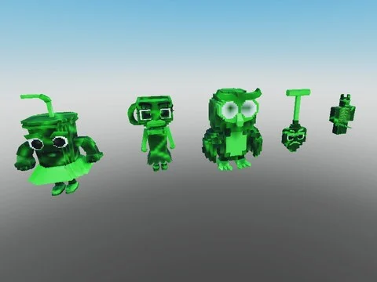

# Brainrots animés — variante Hacker (88)

88 brainrots animés (AnimationController + animations) en variante Hacker (hacker), extraits de Steal an Spooky Egg.

- **Catégorie** : [Pets & meshes](../Pets%20&%20meshes.md)
- **Sous-catégorie** : [Brainrots animés](Brainrots%20anim%C3%A9s.md)
- **Type** : Pack de fichiers
- **Contenu** : 88 fichiers · 0,8 Mo
- **Fichier source** : `Assets/packs/Brainrots_Animated/Hacker` (dans le vault)

## Fichiers (88)

- `Hacker 1x1x1x1.rbxm`
- `Hacker Agarrini La Pallini.rbxm`
- `Hacker Avocadini Guffo.rbxm`
- `Hacker Ballerina Cappuccina.rbxm`
- `Hacker Ballerino Lololo.rbxm`
- `Hacker Bambini Crostini.rbxm`
- `Hacker Banana Dancana.rbxm`
- `Hacker Bananini Kittini.rbxm`
- `Hacker Bananita Dolphinita.rbxm`
- `Hacker Blueberrinni Octopusini.rbxm`
- `Hacker Bobrito Bandito.rbxm`
- `Hacker Bombardiro Crocodilo.rbxm`
- `Hacker Bombombini Gusini.rbxm`
- `Hacker Boneca Ambalabu.rbxm`
- `Hacker Brr Brr Patapim.rbxm`
- `Hacker Brri Brri Bicus Dicus.rbxm`
- `Hacker Burbaloni Luliloli.rbxm`
- `Hacker Cachorrito Melonito.rbxm`
- `Hacker Cacto Hipopotamo.rbxm`
- `Hacker Cappuccino Assassino.rbxm`
- `Hacker Cavallo Virtuoso.rbxm`
- `Hacker Chef Crabracadabra.rbxm`
- `Hacker Chicleteira Bicicleteira.rbxm`
- `Hacker Chicleteirina Bicicleteirina.rbxm`
- `Hacker Chillin Chili.rbxm`
- `Hacker Chimpanzini Bananini.rbxm`
- `Hacker Cocofanto Elefanto.rbxm`
- `Hacker Dragon Cannelloni.rbxm`
- `Hacker Esok Sekolah.rbxm`
- `Hacker Espresso Signora.rbxm`
- `Hacker Fluri Flura.rbxm`
- `Hacker Frigo Camelo.rbxm`
- `Hacker Ganganzelli Trulala.rbxm`
- `Hacker Gangster Footera.rbxm`
- `Hacker Garamararam.rbxm`
- `Hacker Girafa Celeste.rbxm`
- `Hacker Glorbo Fruttodrillo.rbxm`
- `Hacker Gorillo Watermelondrillo.rbxm`
- `Hacker Illuminato Triangolo.rbxm`
- `Hacker Job Job Job Sahur.rbxm`
- `Hacker Karkerkar Kurkur.rbxm`
- `Hacker La Grande Combinasion.rbxm`
- `Hacker La Vacca Saturno Saturnita.rbxm`
- `Hacker Lerulerulerule.rbxm`
- `Hacker Lionel Cactuseli.rbxm`
- `Hacker Lirili Larila.rbxm`
- `Hacker Los Tralaleritos.rbxm`
- `Hacker Madudung.rbxm`
- `Hacker Matteo.rbxm`
- `Hacker Meowl.rbxm`
- `Hacker Noo My Examen.rbxm`
- `Hacker Normal.rbxm`
- `Hacker Nyannini Cattalini.rbxm`
- `Hacker Odin Din Din Dun.rbxm`
- `Hacker Orangutini Ananassini.rbxm`
- `Hacker Orcalero Orcala.rbxm`
- `Hacker Pakrahmatmamat.rbxm`
- `Hacker Pakrahmatmatina.rbxm`
- `Hacker Pandaccini Bananini.rbxm`
- `Hacker Pipi Kiwi.rbxm`
- `Hacker Pipi Potato.rbxm`
- `Hacker Pot Hotspot.rbxm`
- `Hacker Quesadilla Crocodila.rbxm`
- `Hacker Rhino Toasterino.rbxm`
- `Hacker Six Seven.rbxm`
- `Hacker Smurfo Gatto.rbxm`
- `Hacker Strawberrelli Flamingelli.rbxm`
- `Hacker Strawberry Elephant.rbxm`
- `Hacker Svinina Bombardino.rbxm`
- `Hacker Swag Soda.rbxm`
- `Hacker Ta Ta Ta Ta Sahur.rbxm`
- `Hacker Talpa Di Fero.rbxm`
- `Hacker Tigroligre Frutonni.rbxm`
- `Hacker Tim Cheese.rbxm`
- `Hacker Tirilikalika Tirilikalako.rbxm`
- `Hacker Torrtuginni Dragonfrutini.rbxm`
- `Hacker Tralaledon.rbxm`
- `Hacker Tralalero Tralala.rbxm`
- `Hacker Tralalita Tralala.rbxm`
- `Hacker Tric Trac Barabum.rbxm`
- `Hacker Triplito Tralaleritos.rbxm`
- `Hacker Trippi Troppi Troppa Trippa.rbxm`
- `Hacker Trippi Troppi.rbxm`
- `Hacker Trulimero Trulicina.rbxm`
- `Hacker Tung Sahur.rbxm`
- `Hacker W Or L.rbxm`
- `Hacker Yess My Examen.rbxm`
- `Hacker Zibra Zubra Zibralini.rbxm`
