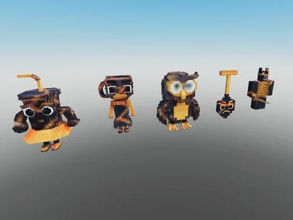

# Brainrots animés — variante Lava (87)

87 brainrots animés (AnimationController + animations) en variante Lava (lave), extraits de Steal an Spooky Egg.

- **Catégorie** : [Pets & meshes](../Pets%20&%20meshes.md)
- **Sous-catégorie** : [Brainrots animés](Brainrots%20anim%C3%A9s.md)
- **Type** : Pack de fichiers
- **Contenu** : 87 fichiers · 0,9 Mo
- **Fichier source** : `Assets/packs/Brainrots_Animated/Lava` (dans le vault)

## Fichiers (87)

- `Lava 1x1x1x1.rbxm`
- `Lava Agarrini La Pallini.rbxm`
- `Lava Avocadini Guffo.rbxm`
- `Lava Ballerina Cappuccina.rbxm`
- `Lava Ballerino Lololo.rbxm`
- `Lava Bambini Crostini.rbxm`
- `Lava Banana Dancana.rbxm`
- `Lava Bananini Kittini.rbxm`
- `Lava Bananita Dolphinita.rbxm`
- `Lava Blueberrinni Octopusini.rbxm`
- `Lava Bobrito Bandito.rbxm`
- `Lava Bombardiro Crocodilo.rbxm`
- `Lava Bombombini Gusini.rbxm`
- `Lava Boneca Ambalabu.rbxm`
- `Lava Brr Brr Patapim.rbxm`
- `Lava Brri Brri Bicus Dicus.rbxm`
- `Lava Burbaloni Luliloli.rbxm`
- `Lava Cachorrito Melonito.rbxm`
- `Lava Cacto Hipopotamo.rbxm`
- `Lava Cappuccino Assassino.rbxm`
- `Lava Cavallo Virtuoso.rbxm`
- `Lava Chef Crabracadabra.rbxm`
- `Lava Chicleteira Bicicleteira.rbxm`
- `Lava Chicleteirina Bicicleteirina.rbxm`
- `Lava Chillin Chili.rbxm`
- `Lava Chimpanzini Bananini.rbxm`
- `Lava Cocofanto Elefanto.rbxm`
- `Lava Dragon Cannelloni.rbxm`
- `Lava Esok Sekolah.rbxm`
- `Lava Espresso Signora.rbxm`
- `Lava Fluri Flura.rbxm`
- `Lava Frigo Camelo.rbxm`
- `Lava Ganganzelli Trulala.rbxm`
- `Lava Gangster Footera.rbxm`
- `Lava Garamararam.rbxm`
- `Lava Girafa Celeste.rbxm`
- `Lava Glorbo Fruttodrillo.rbxm`
- `Lava Gorillo Watermelondrillo.rbxm`
- `Lava Illuminato Triangolo.rbxm`
- `Lava Job Job Job Sahur.rbxm`
- `Lava Karkerkar Kurkur.rbxm`
- `Lava La Grande Combinasion.rbxm`
- `Lava La Vacca Saturno Saturnita.rbxm`
- `Lava Lerulerulerule.rbxm`
- `Lava Lioneo Cactuseli.rbxm`
- `Lava Lirili Larila.rbxm`
- `Lava Los Tralaleritos.rbxm`
- `Lava Madudung.rbxm`
- `Lava Matteo.rbxm`
- `Lava Meowl.rbxm`
- `Lava Noo My Examen.rbxm`
- `Lava Nyannini Cattalini.rbxm`
- `Lava Odin Din Din Dun.rbxm`
- `Lava Orangutini Ananassini.rbxm`
- `Lava Orcalero Orcala.rbxm`
- `Lava Pakrahmatmamat.rbxm`
- `Lava Pakrahmatmatina.rbxm`
- `Lava Pandaccini Bananini.rbxm`
- `Lava Pipi Kiwi.rbxm`
- `Lava Pipi Potato.rbxm`
- `Lava Pot Hotspot.rbxm`
- `Lava Quesadilla Crocodila.rbxm`
- `Lava Rhino Toasterino.rbxm`
- `Lava Six Seven.rbxm`
- `Lava Smurfo Gatto.rbxm`
- `Lava Strawberrelli Flamingelli.rbxm`
- `Lava Strawberry Elephant.rbxm`
- `Lava Svinina Bombardino.rbxm`
- `Lava Swag Soda.rbxm`
- `Lava Ta Ta Ta Ta Sahur.rbxm`
- `Lava Talpa Di Fero.rbxm`
- `Lava Tigroligre Frutonni.rbxm`
- `Lava Tim Cheese.rbxm`
- `Lava Tirilikalika Tirilikalako.rbxm`
- `Lava Torrtuginni Dragonfrutini.rbxm`
- `Lava Tralaledon.rbxm`
- `Lava Tralalero Tralala.rbxm`
- `Lava Tralalita Tralala.rbxm`
- `Lava Tric Trac Barabum.rbxm`
- `Lava Triplito Tralaleritos.rbxm`
- `Lava Trippi Troppi Troppa Trippa.rbxm`
- `Lava Trippi Troppi.rbxm`
- `Lava Trulimero Trulicina.rbxm`
- `Lava Tung Sahur.rbxm`
- `Lava W Or L.rbxm`
- `Lava Yess My Examen.rbxm`
- `Lava Zibra Zubra Zibralini.rbxm`
