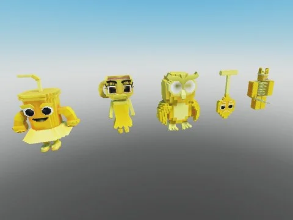

# Brainrots animés — variante Oro (87)

87 brainrots animés (AnimationController + animations) en variante Oro (or), extraits de Steal an Spooky Egg.

- **Catégorie** : [Pets & meshes](../Pets%20&%20meshes.md)
- **Sous-catégorie** : [Brainrots animés](Brainrots%20anim%C3%A9s.md)
- **Type** : Pack de fichiers
- **Contenu** : 87 fichiers · 0,8 Mo
- **Fichier source** : `Assets/packs/Brainrots_Animated/Oro` (dans le vault)

## Fichiers (87)

- `Gold 1x1x1x1.rbxm`
- `Gold Agarrini La Pallini.rbxm`
- `Gold Avocadini Guffo.rbxm`
- `Gold Ballerina Cappuccina.rbxm`
- `Gold Ballerino Lololo.rbxm`
- `Gold Bambini Crostini.rbxm`
- `Gold Banana Dancana.rbxm`
- `Gold Bananini Kittini.rbxm`
- `Gold Bananita Dolphinita.rbxm`
- `Gold Blueberrinni Octopusini.rbxm`
- `Gold Bobrito Bandito.rbxm`
- `Gold Bombardiro Crocodilo.rbxm`
- `Gold Bombombini Gusini.rbxm`
- `Gold Boneca Ambalabu.rbxm`
- `Gold Brr Brr Patapim.rbxm`
- `Gold Brri Brri Bicus Dicus.rbxm`
- `Gold Burbaloni Luliloli.rbxm`
- `Gold Cachorrito Melonito.rbxm`
- `Gold Cacto Hipopotamo.rbxm`
- `Gold Cappuccino Assassino.rbxm`
- `Gold Cavallo Virtuoso.rbxm`
- `Gold Chef Crabracadabra.rbxm`
- `Gold Chicleteira Bicicleteira.rbxm`
- `Gold Chicleteirina Bicicleteirina.rbxm`
- `Gold Chillin Chili.rbxm`
- `Gold Chimpanzini Bananini.rbxm`
- `Gold Cocofanto Elefanto.rbxm`
- `Gold Dragon Cannelloni.rbxm`
- `Gold Esok Sekolah.rbxm`
- `Gold Espresso Signora.rbxm`
- `Gold Fluri Flura.rbxm`
- `Gold Frigo Camelo.rbxm`
- `Gold Ganganzelli Trulala.rbxm`
- `Gold Gangster Footera.rbxm`
- `Gold Garamararam.rbxm`
- `Gold Girafa Celeste.rbxm`
- `Gold Glorbo Fruttodrillo.rbxm`
- `Gold Gorillo Watermelondrillo.rbxm`
- `Gold Illuminato Triangolo.rbxm`
- `Gold Job Job Job Sahur.rbxm`
- `Gold Karkerkar Kurkur.rbxm`
- `Gold La Grande Combinasion.rbxm`
- `Gold La Vacca Saturno Saturnita.rbxm`
- `Gold Lerulerulerule.rbxm`
- `Gold Lionel Cactuseli.rbxm`
- `Gold Lirili Larila.rbxm`
- `Gold Los Tralaleritos.rbxm`
- `Gold Madudung.rbxm`
- `Gold Matteo.rbxm`
- `Gold Meowl.rbxm`
- `Gold Noo My Examen.rbxm`
- `Gold Nyannini Cattalini.rbxm`
- `Gold Odin Din Din Dun.rbxm`
- `Gold Orangutini Ananassini.rbxm`
- `Gold Orcalero Orcala.rbxm`
- `Gold Pakrahmatmamat.rbxm`
- `Gold Pakrahmatmatina.rbxm`
- `Gold Pandaccini Bananini.rbxm`
- `Gold Pipi Kiwi.rbxm`
- `Gold Pipi Potato.rbxm`
- `Gold Pot Hotspot.rbxm`
- `Gold Quesadilla Crocodila.rbxm`
- `Gold Rhino Toasterino.rbxm`
- `Gold Six Seven.rbxm`
- `Gold Smurfo Gatto.rbxm`
- `Gold Strawberrelli Flamingelli.rbxm`
- `Gold Strawberry Elephant.rbxm`
- `Gold Svinina Bombardino.rbxm`
- `Gold Swag Soda.rbxm`
- `Gold Ta Ta Ta Ta Sahur.rbxm`
- `Gold Talpa Di Fero.rbxm`
- `Gold Tigroligre Frutonni.rbxm`
- `Gold Tim Cheese.rbxm`
- `Gold Tirilikalika Tirilikalako.rbxm`
- `Gold Torrtuginni Dragonfrutini.rbxm`
- `Gold Tralaledon.rbxm`
- `Gold Tralalero Tralala.rbxm`
- `Gold Tralalita Tralala.rbxm`
- `Gold Tric Trac Barabum.rbxm`
- `Gold Triplito Tralaleritos.rbxm`
- `Gold Trippi Troppi Troppa Trippa.rbxm`
- `Gold Trippi Troppi.rbxm`
- `Gold Trulimero Trulicina.rbxm`
- `Gold Tung Sahur.rbxm`
- `Gold W Or L.rbxm`
- `Gold Yess My Examen.rbxm`
- `Gold Zibra Zubra Zibralini.rbxm`
