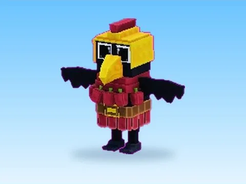

# Brri Brri Bicus Dicus

Modèle en MeshParts « Brri Brri Bicus Dicus ». Aperçu rendu dans Roblox Studio avec ses vraies textures.

- **Catégorie** : [Pets & meshes](../Pets%20&%20meshes.md)
- **Sous-catégorie** : [Brainrots animés](Brainrots%20anim%C3%A9s.md)
- **Type** : Modèle en MeshParts
- **Contenu** : 1 MeshPart
- **Fichier source** : `Assets/packs/Brainrots_Animated/Normal/Brri Brri Bicus Dicus.rbxm` (dans le vault)
