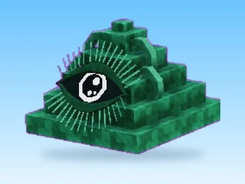

# Illuminato Triangolo

Modèle en MeshParts « Illuminato Triangolo ». Aperçu rendu dans Roblox Studio avec ses vraies textures.

- **Catégorie** : [Pets & meshes](../Pets%20&%20meshes.md)
- **Sous-catégorie** : [Brainrots animés](Brainrots%20anim%C3%A9s.md)
- **Type** : Modèle en MeshParts
- **Contenu** : 1 MeshPart
- **Fichier source** : `Assets/packs/Brainrots_Animated/Normal/Illuminato Triangolo.rbxm` (dans le vault)
