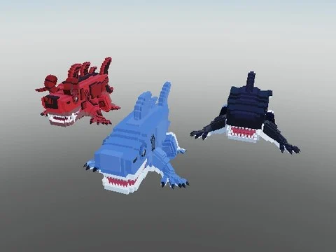

# Los Dons (brainrot, by Witox / sammyni Spookyni)

Modèle de brainrot « Los Dons » (dossier « Los Dons By sammyni Spookyni », partagé par Witox).

- **Catégorie** : [Pets & meshes](../Pets%20&%20meshes.md)
- **Sous-catégorie** : [Brainrots animés](Brainrots%20anim%C3%A9s.md)
- **Type** : Modèle Roblox (.rbxm)
- **Contenu** : 1 fichier · 27 Ko
- **Jeu d'origine** : Steal a Brainrot
- **Fichier source** : `Assets/models/ByType/Pets/Los Dons (by Witox).rbxm` (dans le vault)
