# Bâtiments

Sous-catégorie de [Pets & meshes](../Pets%20%26%20meshes.md) · **14 éléments**

| Aperçu | Élément | Infos |
| --- | --- | --- |
| 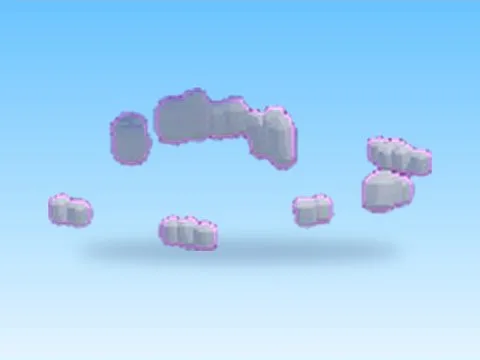 | [Borders · Tweeting Simulator](Borders%20%C2%B7%20Tweeting%20Simulator.md) | Modèle en MeshParts · 24 MeshParts |
| 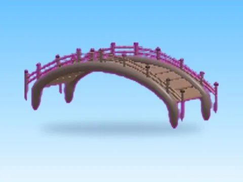 | [Bridge · Rebirth Champions X](Bridge%20%C2%B7%20Rebirth%20Champions%20X.md) | Modèle en MeshParts · 5 MeshParts |
| 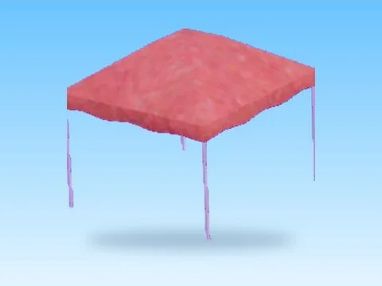 | [Canopy Tent · Mining Masters](Canopy%20Tent%20%C2%B7%20Mining%20Masters.md) | Modèle en MeshParts · 2 MeshParts |
| 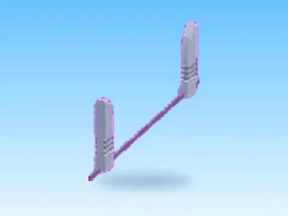 | [Door · Pet Pharmica](Door%20%C2%B7%20Pet%20Pharmica.md) | Modèle en MeshParts · 1 Part · 8 MeshParts |
| 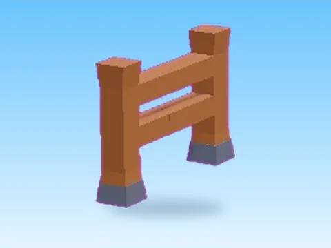 | [Fence · Hatching Simulator](Fence%20%C2%B7%20Hatching%20Simulator.md) | Modèle en MeshParts · 3 MeshParts |
|  | [Fence1 · Rebirth Champions X](Fence1%20%C2%B7%20Rebirth%20Champions%20X.md) | Modèle en MeshParts · 6 MeshParts |
| 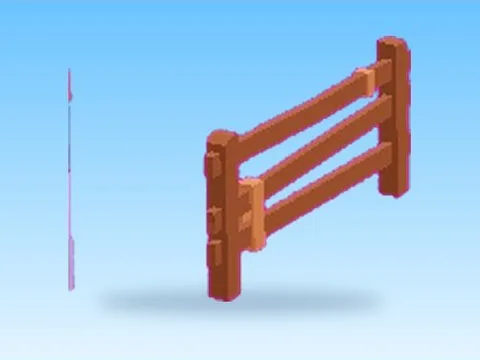 | [Fences Model · Mining Masters](Fences%20Model%20%C2%B7%20Mining%20Masters.md) | Modèle en MeshParts · 5 MeshParts |
| 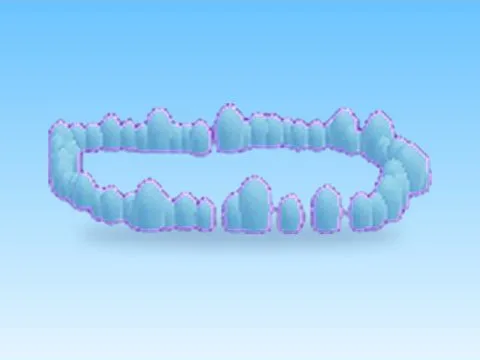 | [Frost Barriers Model · Hatching Simulator](Frost%20Barriers%20Model%20%C2%B7%20Hatching%20Simulator.md) | Modèle en MeshParts · 71 MeshParts |
| 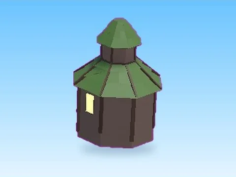 | [Jungle House · Pet Pharmica](Jungle%20House%20%C2%B7%20Pet%20Pharmica.md) | Modèle en MeshParts · 19 Parts · 6 MeshParts |
| 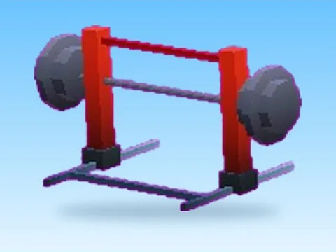 | [Lift · +1 Jump Every Second](Lift%20%C2%B7%20%2B1%20Jump%20Every%20Second.md) | Modèle en MeshParts · 6 MeshParts |
| 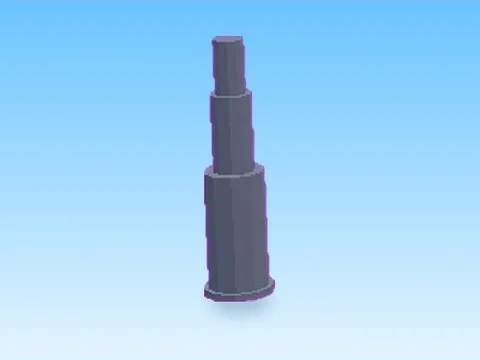 | [Pillars · Robot Simulator](Pillars%20%C2%B7%20Robot%20Simulator.md) | Modèle en MeshParts · 4 MeshParts |
| 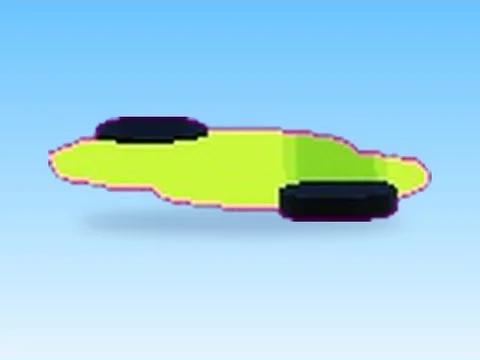 | [Pipe2 · Punch Simulator](Pipe2%20%C2%B7%20Punch%20Simulator.md) | Modèle en MeshParts · 6 MeshParts |
| 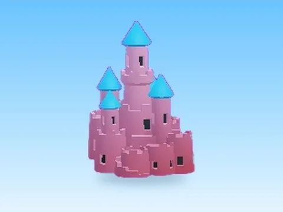 | [Sandcastle · Punch Simulator](Sandcastle%20%C2%B7%20Punch%20Simulator.md) | Modèle en MeshParts · 1 MeshPart |
| 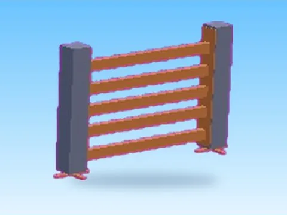 | [Secured Fence · Hatching Simulator](Secured%20Fence%20%C2%B7%20Hatching%20Simulator.md) | Modèle en MeshParts · 13 MeshParts |
