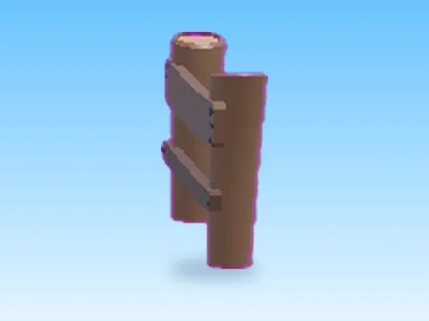

# Fence1 · Rebirth Champions X

Modèle en MeshParts « Fence1 » (Rebirth Champions X). Aperçu rendu dans Roblox Studio avec ses vraies textures.

- **Catégorie** : [Pets & meshes](../Pets%20&%20meshes.md)
- **Sous-catégorie** : [Bâtiments](B%C3%A2timents%20%28Pets%20&%20meshes%29.md)
- **Type** : Modèle en MeshParts
- **Contenu** : 6 MeshParts
- **Jeu d'origine** : Rebirth Champions X
- **Fichier source** : `Assets/models/ByType/Buildings/RebirthChampionsX_Fence1.rbxm` (dans le vault)
