# Chapeaux & accessoires

Sous-catégorie de [Pets & meshes](../Pets%20&%20meshes.md) · **16 éléments**

| Aperçu | Élément | Infos |
| --- | --- | --- |
|  | [Admin Glider · Robot Simulator](Admin%20Glider%20%C2%B7%20Robot%20Simulator.md) | Modèle en MeshParts · 3 MeshParts |
| 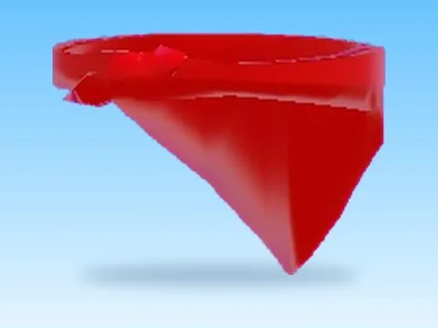 | [Bandana · Magnet Simulator 2](Bandana%20%C2%B7%20Magnet%20Simulator%202.md) | Modèle en MeshParts · 1 MeshPart |
| 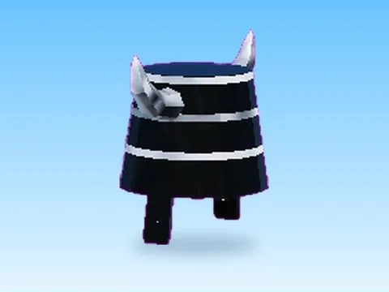 | [Bucket · Magnet Simulator 2](Bucket%20%C2%B7%20Magnet%20Simulator%202.md) | Modèle en MeshParts · 1 MeshPart |
| 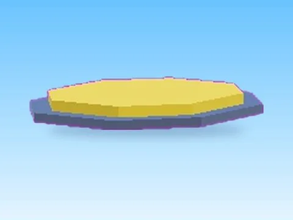 | [Clear1 · Cashgrab Bridge](Clear1%20%C2%B7%20Cashgrab%20Bridge.md) | Modèle en MeshParts · 2 MeshParts |
| 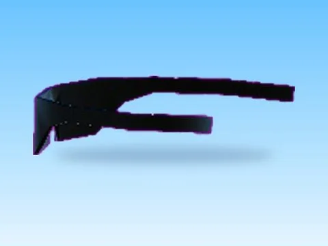 | [Clockworks · Magnet Simulator 2](Clockworks%20%C2%B7%20Magnet%20Simulator%202.md) | Modèle en MeshParts · 1 MeshPart |
|  | [Diamond Sword · Punch Simulator](Diamond%20Sword%20%C2%B7%20Punch%20Simulator.md) | Modèle en MeshParts · 1 MeshPart |
| 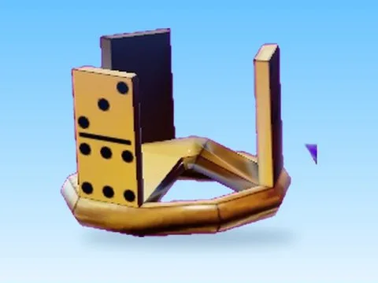 | [Domino · Magnet Simulator 2](Domino%20%C2%B7%20Magnet%20Simulator%202.md) | Modèle en MeshParts · 1 MeshPart |
| 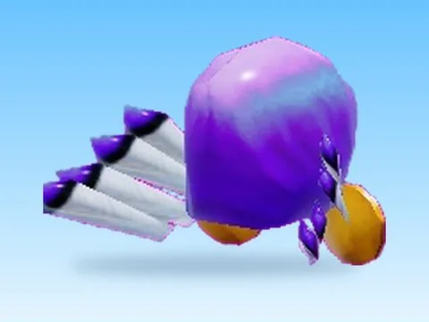 | [Dominus · Magnet Simulator 2](Dominus%20%C2%B7%20Magnet%20Simulator%202.md) | Modèle en MeshParts · 1 MeshPart |
| 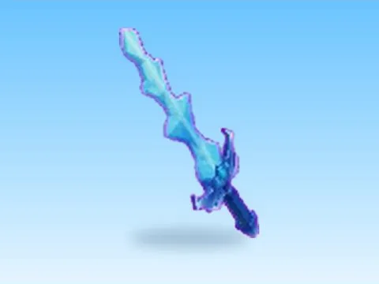 | [Dragon Sword · Punch Simulator](Dragon%20Sword%20%C2%B7%20Punch%20Simulator.md) | Modèle en MeshParts · 1 MeshPart |
|  | [Fedora · Magnet Simulator 2](Fedora%20%C2%B7%20Magnet%20Simulator%202.md) | Modèle en MeshParts · 1 MeshPart |
|  | [Prismatic Star · Punch Simulator](Prismatic%20Star%20%C2%B7%20Punch%20Simulator.md) | Modèle en MeshParts · 1 MeshPart |
| 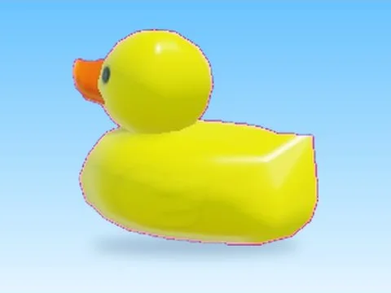 | [Rubber Duckie · Magnet Simulator 2](Rubber%20Duckie%20%C2%B7%20Magnet%20Simulator%202.md) | Modèle en MeshParts · 1 MeshPart |
| 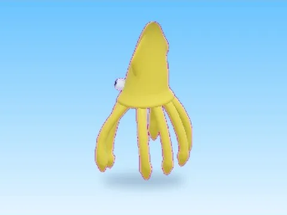 | [Tentacles · Magnet Simulator 2](Tentacles%20%C2%B7%20Magnet%20Simulator%202.md) | Modèle en MeshParts · 1 MeshPart |
| 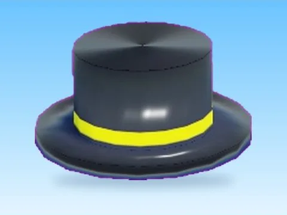 | [Top Hat · Magnet Simulator 2](Top%20Hat%20%C2%B7%20Magnet%20Simulator%202.md) | Modèle en MeshParts · 1 MeshPart |
| 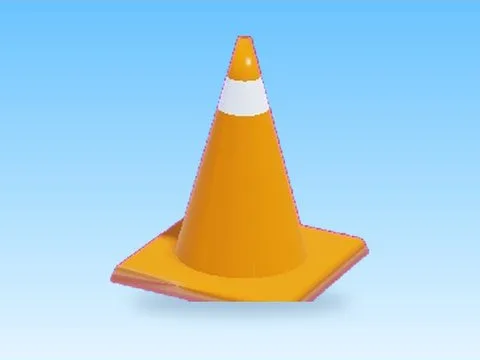 | [Traffic Cone · Magnet Simulator 2](Traffic%20Cone%20%C2%B7%20Magnet%20Simulator%202.md) | Modèle en MeshParts · 1 MeshPart |
| 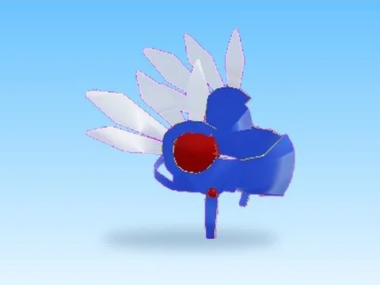 | [Valkyrie · Magnet Simulator 2](Valkyrie%20%C2%B7%20Magnet%20Simulator%202.md) | Modèle en MeshParts · 1 MeshPart |
