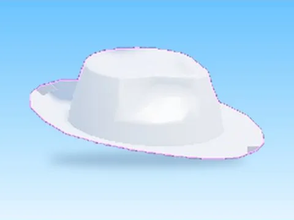

# Fedora · Magnet Simulator 2

Modèle en MeshParts « Fedora » (Magnet Simulator 2). Aperçu rendu dans Roblox Studio avec ses vraies textures.

- **Catégorie** : [Pets & meshes](../Pets%20&%20meshes.md)
- **Sous-catégorie** : [Chapeaux & accessoires](Chapeaux%20&%20accessoires%20%28Pets%20&%20meshes%29.md)
- **Type** : Modèle en MeshParts
- **Contenu** : 1 MeshPart
- **Jeu d'origine** : Magnet Simulator 2
- **Fichier source** : `models/ByType/Accessories_Hats/MagnetSim2_Fedora.rbxm` (dans ta bibliothèque `rblx\lib`)
