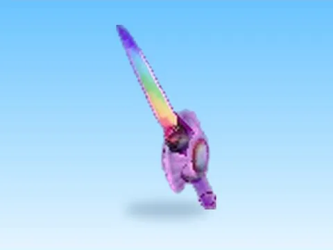

# Prismatic Star · Punch Simulator

Modèle en MeshParts « Prismatic Star » (Punch Simulator). Aperçu rendu dans Roblox Studio avec ses vraies textures.

- **Catégorie** : [Pets & meshes](../Pets%20%26%20meshes.md)
- **Sous-catégorie** : [Chapeaux & accessoires](Chapeaux%20%26%20accessoires%20%28Pets%20%26%20meshes%29.md)
- **Type** : Modèle en MeshParts
- **Contenu** : 1 MeshPart
- **Jeu d'origine** : Punch Simulator
- **Fichier source** : `models/ByType/Accessories_Hats/PunchSim_PrismaticStar.rbxm` (dans ta bibliothèque `rblx\lib`)
