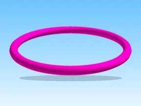

# Both Loop1 · Robot Simulator

Modèle en MeshParts « Both Loop1 » (Robot Simulator). Aperçu : forme du mesh principal (sans texture).

- **Catégorie** : [Pets & meshes](../Pets%20&%20meshes.md)
- **Sous-catégorie** : [Coffres & collectibles](Coffres%20&%20collectibles%20%28Pets%20&%20meshes%29.md)
- **Type** : Modèle en MeshParts
- **Contenu** : 1 MeshPart
- **Jeu d'origine** : Robot Simulator
- **Fichier source** : `models/ByType/Collectibles_Chests/RobotSim_BothLoop1.rbxm` (dans ta bibliothèque `rblx\lib`)
