# Coffres & collectibles

Sous-catégorie de [Pets & meshes](../Pets%20&%20meshes.md) · **16 éléments**

| Aperçu | Élément | Infos |
| --- | --- | --- |
| 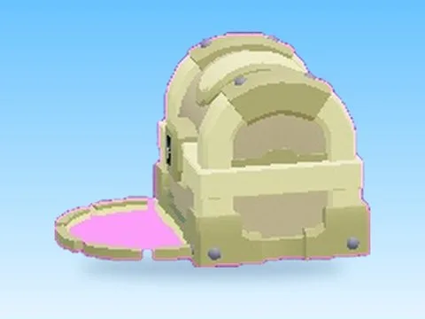 | [Beach · Rebirth Champions X](Beach%20%C2%B7%20Rebirth%20Champions%20X.md) | Modèle en MeshParts · 19 MeshParts |
|  | [Both Loop1 · Robot Simulator](Both%20Loop1%20%C2%B7%20Robot%20Simulator.md) | Modèle en MeshParts · 1 MeshPart |
| 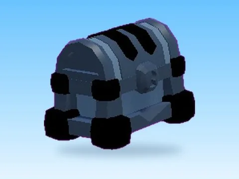 | [Cave Chest · Punch Simulator](Cave%20Chest%20%C2%B7%20Punch%20Simulator.md) | Modèle en MeshParts · 11 MeshParts |
| 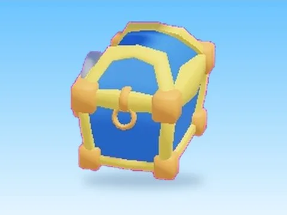 | [Chest By Devv Nexus · Mining Masters](Chest%20By%20Devv%20Nexus%20%C2%B7%20Mining%20Masters.md) | Modèle en MeshParts · 8 MeshParts |
| 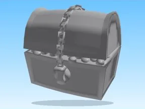 | [Chests · Magnet Simulator 2](Chests%20%C2%B7%20Magnet%20Simulator%202.md) | Modèle en MeshParts · 5 MeshParts |
| 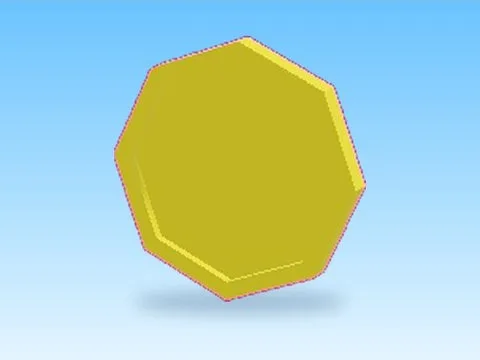 | [Coin · Lib perso](Coin%20%C2%B7%20Lib%20perso.md) | Modèle en MeshParts · 1 MeshPart |
|  | [Coins · Pet Pharmica](Coins%20%C2%B7%20Pet%20Pharmica.md) | Modèle en MeshParts · 44 MeshParts |
| 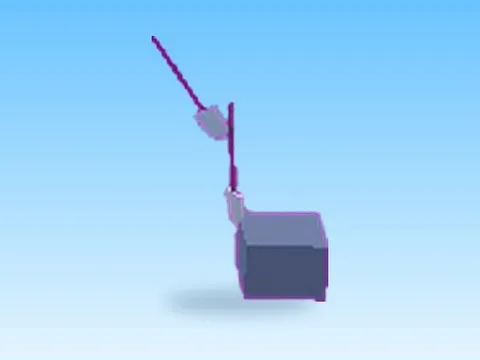 | [Daily Reward · Robot Simulator](Daily%20Reward%20%C2%B7%20Robot%20Simulator.md) | Modèle en MeshParts · 2 Parts · 11 MeshParts |
| 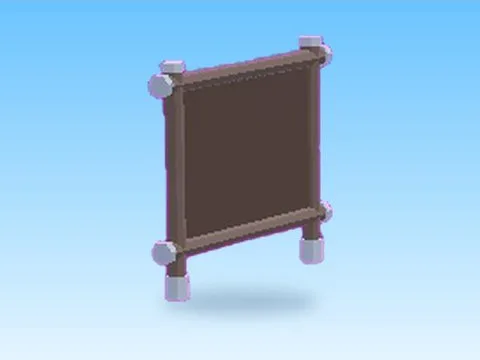 | [Gems · Pet Pharmica](Gems%20%C2%B7%20Pet%20Pharmica.md) | Modèle en MeshParts · 2 Parts · 12 MeshParts |
| 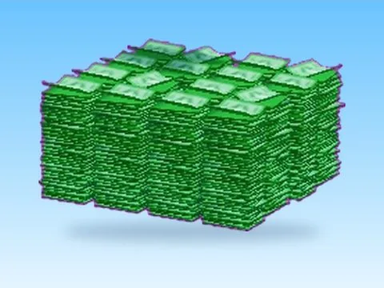 | [Money · Glass Bridge](Money%20%C2%B7%20Glass%20Bridge.md) | Modèle en MeshParts · 16 MeshParts |
|  | [Montede Coins · Pet Pharmica](Montede%20Coins%20%C2%B7%20Pet%20Pharmica.md) | Modèle en MeshParts · 15 MeshParts |
|  | [Ore40 · Mining Masters](Ore40%20%C2%B7%20Mining%20Masters.md) | Modèle en MeshParts · 1 MeshPart |
| 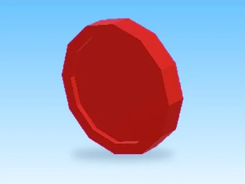 | [Red · Magnet Simulator 2](Red%20%C2%B7%20Magnet%20Simulator%202.md) | Modèle en MeshParts · 1 MeshPart |
| 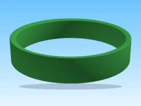 | [Sellpoints · Tweeting Simulator](Sellpoints%20%C2%B7%20Tweeting%20Simulator.md) | Modèle en MeshParts · 7 Parts · 7 MeshParts |
| 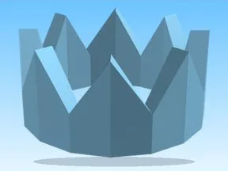 | [Spawned · Robot Simulator](Spawned%20%C2%B7%20Robot%20Simulator.md) | Modèle en MeshParts · 11 MeshParts |
| 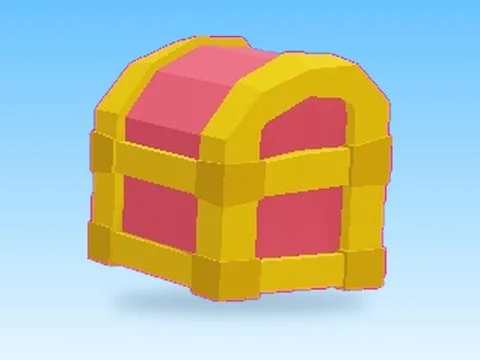 | [Treasure Chest · Pet Pharmica](Treasure%20Chest%20%C2%B7%20Pet%20Pharmica.md) | Modèle en MeshParts · 1 Part · 4 MeshParts |
