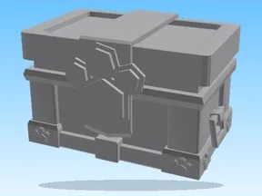

# Coins · Pet Pharmica

Modèle en MeshParts « Coins » (Pet Pharmica). Aperçu : forme du mesh principal (sans texture).

- **Catégorie** : [Pets & meshes](../Pets%20%26%20meshes.md)
- **Sous-catégorie** : [Coffres & collectibles](Coffres%20%26%20collectibles%20%28Pets%20%26%20meshes%29.md)
- **Type** : Modèle en MeshParts
- **Contenu** : 44 MeshParts
- **Jeu d'origine** : Pet Pharmica
- **Fichier source** : `models/ByType/Collectibles_Chests/PetPharmica_Coins.rbxm` (dans ta bibliothèque `rblx\lib`)
