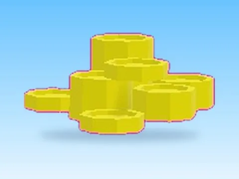

# Montede Coins · Pet Pharmica

Modèle en MeshParts « Montede Coins » (Pet Pharmica). Aperçu rendu dans Roblox Studio avec ses vraies textures.

- **Catégorie** : [Pets & meshes](../Pets%20&%20meshes.md)
- **Sous-catégorie** : [Coffres & collectibles](Coffres%20&%20collectibles%20%28Pets%20&%20meshes%29.md)
- **Type** : Modèle en MeshParts
- **Contenu** : 15 MeshParts
- **Jeu d'origine** : Pet Pharmica
- **Fichier source** : `Assets/models/ByType/Collectibles_Chests/PetPharmica_MontedeCoins.rbxm` (dans le vault)
