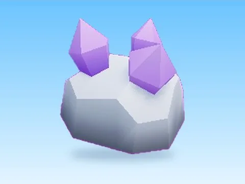

# Ore40 · Mining Masters

Modèle en MeshParts « Ore40 » (Mining Masters). Aperçu rendu dans Roblox Studio avec ses vraies textures.

- **Catégorie** : [Pets & meshes](../Pets%20%26%20meshes.md)
- **Sous-catégorie** : [Coffres & collectibles](Coffres%20%26%20collectibles%20%28Pets%20%26%20meshes%29.md)
- **Type** : Modèle en MeshParts
- **Contenu** : 1 MeshPart
- **Jeu d'origine** : Mining Masters
- **Fichier source** : `models/ByType/Collectibles_Chests/MiningMasters_Ore40.rbxm` (dans ta bibliothèque `rblx\lib`)
